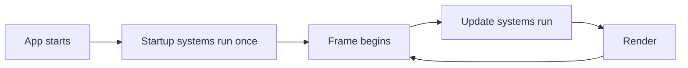

# Bevy concepts

How Bevy works, in plain terms, using this project's code as the examples. Written for someone who knows game engines but not Bevy. Version: Bevy 0.20.1.

Sections marked **Not used yet** describe things Bevy offers that this project has not touched. They come from reading `bevy-src/`, not from running them here. Treat them as leads, not proven patterns. Short verified code snippets also live in `dev-docs/bevy-notes.md`. Our own reusable design decisions built on top of Bevy (such as `allow_sliding`) are in `dev-docs/BEVY-ADDITIONS.md`.

## The big idea: ECS

Bevy has no "game object" class with behaviour. It uses an Entity Component System:

| Term | What it is | Example here |
|---|---|---|
| **Entity** | An ID. It has no data or behaviour of its own. | Guy, the camera |
| **Component** | A plain piece of data attached to an entity. | `Player`, `Transform`, `Sprite` |
| **System** | A normal Rust function that reads and changes components. All behaviour lives here. | `move_player`, `animate_player` |
| **Resource** | One global value, not tied to an entity. | `Time`, `ButtonInput<KeyCode>`, `AssetServer` |

An entity is defined by which components it has. Guy is "an entity with `Player`, `AseAnimation`, `Sprite` and `Transform`". There is no `Guy` class. If you add a `Health` component to an entity, every system that asks for `Health` now sees it.

## App: the application shell

`App` is the whole game. `main.rs` builds one and runs it:

```rust
App::new()
    .add_plugins(DefaultPlugins.set(ImagePlugin::default_nearest()))
    .add_plugins(AsepriteUltraPlugin)
    .add_plugins((camera::CameraPlugin, player::PlayerPlugin))
    .run();
```

`run()` opens the window and starts the game loop. It does not return until the window closes.

## Plugins: how code is organised

A plugin is a bundle of setup: systems, resources and other plugins. Everything in Bevy is a plugin, including rendering and input. `DefaultPlugins` is the standard set (window, rendering, input, assets, logging).

Our own code follows the same pattern. One plugin per feature:

```rust
pub struct PlayerPlugin;

impl Plugin for PlayerPlugin {
    fn build(&self, app: &mut App) {
        app.add_systems(Startup, spawn_player)
            .add_systems(Update, (move_player, animate_player).chain());
    }
}
```

`.set(ImagePlugin::default_nearest())` changes one setting of a plugin inside `DefaultPlugins`. This is how we get sharp pixels instead of blurry ones.

## Systems and schedules: when code runs

A system is a function. Its arguments say what data it needs, and Bevy supplies them:

```rust
fn move_player(
    input: Res<ButtonInput<KeyCode>>,          // a resource, read only
    time: Res<Time>,
    window: Single<&Window>,                    // the one entity that has a Window
    mut query: Query<(&mut Transform, &mut Player)>, // every entity with both components
) { ... }
```

You never call a system yourself. You register it in a **schedule**, and Bevy runs it:

| Schedule | When | Used for |
|---|---|---|
| `Startup` | Once, before the first frame | Spawning Guy and the camera |
| `Update` | Every frame | Input, movement, animation |



Other schedules exist (for example fixed-timestep and state transition schedules). We have not used them.

### Ordering

Systems in the same schedule may run in any order, and in parallel, unless they do not touch the same data. When order matters, say so:

```rust
(move_player, animate_player).chain()
```

`.chain()` runs `move_player` first, then `animate_player`. We need that because the animation reads what the movement decided in the same frame.

Bevy works out parallelism from the function arguments. A system that takes `&mut Transform` cannot run at the same time as another that touches `Transform`. You do not write locks.

## Components: data on entities

Any Rust struct or enum can be a component by deriving `Component`:

```rust
#[derive(Component)]
struct Player {
    facing: Facing,
    walking: bool,
    playing: &'static str,
}
```

Built-in components we use:

- `Transform`: position, rotation and scale. Guy's `translation` is his world position, and `scale.x = -1.0` flips him sideways.
- `Sprite`: draws an image. Our Aseprite plugin fills in the image.
- `Camera2d`: marks an entity as the 2D camera.

Bevy has "required components": spawning `Camera2d` also adds the other components a camera needs. This replaced the old bundle types such as `SpriteBundle`, which no longer exist.

## Commands: creating and removing entities

`Commands` queues changes (spawn, despawn, add or remove a component). The changes apply at a safe point later in the frame, not instantly.

```rust
fn spawn_player(mut commands: Commands, server: Res<AssetServer>) {
    commands.spawn((
        Player { facing: Facing::Down, walking: false, playing: "Idle" },
        AseAnimation { /* ... */ },
        Sprite::default(),
        Transform::default(),
    ));
}
```

A tuple of components in `spawn` makes one entity with all of them.

## Queries: finding entities

A `Query` gives you every entity that has the components you list:

- `Query<(&mut Transform, &mut Player)>`: all entities with both. `&mut` means you may change them.
- `Query<&Transform, With<Player>>`: filters without reading `Player`'s data. (Pattern from the plugin's example, not yet used by us.)
- `Single<&Window>`: exactly one match. The system is skipped if there is not exactly one.

Iterate with `for (mut transform, mut player) in &mut query { ... }`.

## Resources: global state

A resource is a single global value. Ones we use:

| Resource | Purpose |
|---|---|
| `Time` | `time.delta_secs()` is the time since the last frame. Multiply speeds by it. |
| `ButtonInput<KeyCode>` | Keyboard state. `.pressed(KeyCode::ArrowLeft)` is true while held. |
| `AssetServer` | Loads files from the game's `assets/` folder. |
| `ClearColor` | The background colour. We insert our own in `CameraPlugin`. |

Define your own with `#[derive(Resource)]` and add it with `app.insert_resource(...)`.

## Assets

Files load through the `AssetServer`, which returns a handle straight away and loads in the background:

```rust
aseprite: server.load("art/characters/Guy.aseprite")
```

The path is relative to the game's `assets/` folder (`games/long-way/assets/`). Until the file finishes loading the sprite does not appear. A binary started directly (not through `cargo run`) looks for `assets/` next to the executable. Set `BEVY_ASSET_ROOT` to the game folder in that case.

Hot reload of changed files needs Bevy's `file_watcher` feature. We have not enabled it.

## Aseprite animation (`bevy_aseprite_ultra`)

The plugin teaches Bevy to load `.aseprite` files. An entity gets an `AseAnimation` component plus a `Sprite`. The plugin changes the sprite's image every frame.

- An animation is chosen by **tag name**: `Animation::tag("Idle")`. Tag names are case sensitive and come straight from Aseprite.
- `play_loop("Walk")` switches animation. We call it only when the tag changes, so the animation does not restart every frame.
- Frame durations and loops come from the Aseprite file.
- A file with no tags (the trees) plays every frame with `Animation::default()`. No tag name is needed.

This is why layers and tags in Aseprite are the contract between art and code in this project.

## Camera, window and the "canvas"

| Term | What it is |
|---|---|
| `Window` | The OS window. |
| `Camera2d` and `Projection` | What the camera shows. This sets the visible world area. |
| Render target | An off-screen image the camera draws to (not used yet). |

We use a fixed-height orthographic projection:

```rust
Projection::Orthographic(OrthographicProjection {
    scaling_mode: ScalingMode::FixedVertical { viewport_height: VIEW_HEIGHT },
    ..OrthographicProjection::default_2d()
})
```

`viewport_height` is how many world units fit vertically. Width follows the window shape. **A bigger window does not make Guy smaller. A bigger `viewport_height` does.** With `VIEW_HEIGHT = 1200` and Guy 60 pixels tall, Guy is one twentieth of the screen height.

World units here equal art pixels, so a 60 pixel sprite is 60 units wide. Screen pixels only match art pixels when the window height equals `viewport_height`. Otherwise the art is scaled, and non-whole scales can make pixels uneven (see `adr-e7` in `dev-docs/adr/ENGINE.md`).

World coordinates: the centre is (0, 0), x grows right and y grows up.

## Draw order (z)

In 2D, the `z` of a `Transform` decides what draws on top: a higher `z` draws in front. Bevy does not sort by `y` for you. For a top-down game, Guy should walk behind a tree when he is above it and in front when below. We do this ("y-sorting") with a small system in `depth.rs`:

```rust
fn sort_by_feet(mut query: Query<(&mut Transform, &DepthSort)>) {
    for (mut transform, sort) in &mut query {
        transform.translation.z = -sort.feet_y(transform.translation.y) * Z_PER_Y;
    }
}
```

Lower feet on screen give a higher `z`, so they draw in front. `DepthSort` is a component: any entity that has it (Guy, each tree) is sorted. Systems that read or write `Transform` do not need to know about drawing order.

## Collision

Bevy 0.20 has no built-in 2D collision, and we do not use a physics crate. Collision here is plain arithmetic in `collision.rs`:

- A `Trunk` component holds a tree's solid edges in world coordinates.
- `resolve(old, new, trunks)` takes Guy's feet position before and after a move and returns where he may end up. It checks each axis on its own, so Guy slides along a trunk.
- `move_feet(...)` wraps `resolve` and adds the forgiving behaviour (`allow_sliding`): after pushing into a trunk for 0.2 seconds, Guy is slid past a nearby edge. The time he has been pushing is kept in a `SlideAssist` component on Guy.
- The blocked area is a rectangle around the trunk. Its sides, bottom and top come from Guy's size and three rules (see `adr-lw1` in `dev-docs/adr/LONG-WAY.md`).

`move_player` calls `move_feet` with `trunks: Query<&Trunk>`, a query that finds every trunk.

The plugin takes a setting: `CollisionPlugin { allow_sliding: true }` in `main.rs`. A plugin can be a struct with fields, and `build` stores the setting as a resource (`CollisionSettings`) that systems read with `Res<CollisionSettings>`. This is how a game configures shared code. The rule is a plain function with unit tests, so `./dev-scripts/rust.sh test long-way` checks it without opening the game.

## Gizmos (debug drawing)

`Gizmos` is a system parameter for drawing lines and shapes for one frame, used for debugging:

```rust
gizmos.rect_2d(Isometry2d::from_translation(centre), size, Color::srgb(1.0, 0.1, 0.1));
```

Gizmos draw lines and shapes for one frame without entities. In 2D they are always drawn on top of everything, so they cannot sit in a layer. Long Way draws its debug overlays as sprites instead (`collision_debug.rs`).

## Text

Two kinds of text, both in the `2d` feature set with the built-in font:

- `Text2d` is text in the world. It moves with the camera and has a position like a sprite. The grid numbers use it (`debug.rs`).
- `Text` with a `Node` is UI. It is placed on the screen in window pixels, not world units. The info box uses it, with `position_type: Absolute`, `top` and `left`.

Size and colour come from `TextFont::from_font_size(16.0)` and `TextColor(color)`.

## Input

Read the keyboard from `Res<ButtonInput<KeyCode>>`. `pressed` is true while held. The same resource also offers `just_pressed` and `just_released` (seen in Bevy examples, not used by us yet).

Use `pressed` for walking, which should continue while the key is held (Long Way is real-time). Use `just_pressed` when one key press should be one action, such as opening a menu or advancing dialogue.

## Movement

There is no physics engine in this project. Movement is plain arithmetic on `Transform`:

```rust
transform.translation += direction.normalize() * WALK_SPEED * time.delta_secs();
```

`normalize()` keeps diagonal speed equal to straight speed. `delta_secs()` makes speed independent of frame rate. The edge limit is `clamp` on the position, using half the visible size computed from the window shape.

## Events and messages

**Not used yet.** Bevy lets systems talk without calling each other: one system writes a message, others read it. In 0.20 these are called messages (`MessageReader<T>`, as in `WindowResized` handling in the Bevy examples). The plugin also sends `AnimationEvents::Finished`. This is the likely tool for turn-based actions ("player moved", "enemy died").

## States

**Not used yet.** Bevy has built-in app states (loading, menu, playing, game over) that switch groups of systems on and off. The `bevy_state` feature is part of the default app features we depend on. The architecture notes in `CLAUDE.md` plan to use it for app flow and turn phase.

## Cargo features and build profiles

Bevy is split into many optional pieces called features. We turn off the defaults and keep only the 2D set:

```toml
bevy = { version = "=0.20.1", default-features = false, features = ["2d"] }
```

This leaves out 3D and keeps the web build smaller. `bevy_aseprite_ultra` adds `bevy_ui` as a side effect.

The dev profile builds Bevy itself with optimisation (`opt-level = 3`) and our own code lightly (`opt-level = 1`). Unoptimised Bevy is too slow to play. Build times are in `dev-docs/bevy-notes.md`: a small change builds in about 5 to 8 seconds, while adding a dependency takes minutes.

## Project layout

```
Cargo.toml                 # workspace root
games/long-way/
├── Cargo.toml
├── assets/
└── src/
    ├── main.rs        # builds the App, adds plugins
    ├── camera.rs      # CameraPlugin: camera, background colour, VIEW_HEIGHT
    ├── player.rs      # PlayerPlugin: Guy spawn, movement, animation
    ├── trees.rs       # TreesPlugin: spawns the two trees and their trunks
    ├── collision.rs   # CollisionPlugin: blocking rules, outline, sliding
    └── depth.rs       # DepthPlugin: draw order sorted by feet
```

One plugin per feature, each owning its components and systems, is the shape each game will grow in. The repo is a Cargo workspace: each game is a crate in `games/`, and they share one `target/` folder so Bevy compiles once.

## Where to look things up

1. `dev-docs/bevy-notes.md`: short verified snippets for this version.
2. `bevy-src/examples/`: official examples for exactly 0.20.1. Search with grep.
3. `bevy-src/_release-content/migration-guides/`: what changed from the previous version.
4. docs.rs for `bevy` 0.20.1, and the Rust LSP for signatures.
5. The plugin's own `examples/` (for example `move_player.rs`) in `~/.cargo/registry/src/*/bevy_aseprite_ultra-0.10.0/`.
