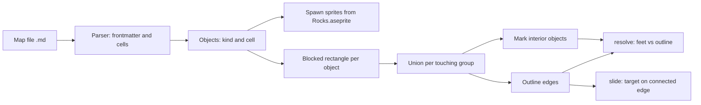

# Collision research and rock geometry

Background for the collision work in Long Way: the approaches that were compared, why the outline approach was chosen, the rock geometry, and the sources. Moved from the plan `PLAN-forest-collision.md` when it was completed (2026-11-01). The decisions are in `dev-docs/adr/LONG-WAY.md` (`adr-lw1` to `adr-lw11`). The rules the code follows are in `dev-docs/BEVY-ADDITIONS.md`, section "Collision and sliding rules". How to write a map is in `dev-docs/GAME-MAPS.md`.

Some statements below describe the state when the research was written, for example "Slide design to settle". The final values are in `adr-lw10`.

## Rock geometry

- Footprint: 2x2 cells = 128 x 128. Inset 10% on the left, right and top, and not at the bottom (changed on 2026-11-01, so the bottom line sits on the lowest art pixel): 102.4 wide and 115.2 high.
- Blocked area for the feet: that rectangle grown sideways by Guy's half width (20). Result 142.4 wide.
- Two rocks whose blocked areas touch or overlap join into one cluster. Rocks 3 or more cells apart leave a gap of about 50 pixels that Guy can walk through, so they are separate clusters.
- Everything inside a cluster is unreachable, so interior rocks need no collision test.

The vertical margin is 0: the blocked area ends at the inset rectangle above and at the footprint bottom below. Rocks sort by the bottom of the blocked area plus 1 (`SORT_BIAS`), not by the bottom of the footprint. With the footprint bottom, Guy standing at the blocked bottom (then 12.8 above the footprint bottom, now 0) was drawn behind the rock and looked as if he had walked in. Found by the developer on 2026-11-01. Guy standing below a rock has his upper body over the lower part of the sprite, as with trees.

### Drawn overlap (facts from the art)

- `rock_0.png` and `rock_1.png` are 32x32 pixel art scaled 8x to 256x256. Checked: every 8x8 block is one colour.
- The opaque part of the rock is 232 x 208 of 256 (x 8 to 239, y 16 to 223): 90.6% of the width and 81% of the height.
- Our `Rocks.aseprite` is 128x128, so one art pixel is 4 screen pixels. The rock is about 116 wide. At a pitch of 2 cells (128) two neighbours do **not** touch: 12 pixels of gap.
- To overlap slightly at a pitch of 2 cells, draw the rock larger than its footprint. 160 pixels is exactly 5x the art, so pixels stay even. The rock is then about 145 wide and neighbours overlap by about 17 pixels (about 12%). 192 pixels (6x) overlaps by about 46 pixels.
- `Rocks.aseprite` is therefore kept at the native 32x32 and scaled in the engine by `draw / 32`, which must be a whole number (4 = 128, 5 = 160, 6 = 192). Pixels stay even. Stretching a 128 pixel file to 160 would not (4x to 5x).
- Drawing larger than the footprint does not change collision. The inset footprints are 25.6 apart at a pitch of 2 cells, and Guy's 20 pixel margin each side closes that gap, so the blocked areas join and a cluster has no gaps.

## Collision approaches (research summary)

All blocked areas are axis-aligned rectangles, so the union is a rectilinear shape (horizontal and vertical edges only). The axis based slide rule keeps working on edge segments. Merging also removes seams, where a diagonal move catches on the inner edge between two touching rectangles.

| | A neighbour aware | B boundary polygon | C computed union (+ D cull) | E occupancy grid | F distance field | G physics crate |
|---|---|---|---|---|---|---|
| What | Keep rectangles, slide along a run of touching ones | Hand drawn forest outline | Merge rectangles at startup, collide with the outline | Rasterise blocked areas to a fine grid | Distance field and normal | `avian2d` or `rapier` |
| Authoring effort | none | high | none (cells already painted) | none | none | medium |
| Fixes seams | no | yes | yes | yes | yes | yes |
| Slide along long edges | partly | yes | yes | yes | different rule | different rule |
| Runtime cost | O(objects) | O(edges) | O(edges), less with D | O(1) | O(1) | engine |
| New dependency | no | maybe | no for rectangles | no | no | yes |
| Works on wasm | yes | likely | yes | yes | yes | to check |
| Unit testable without Bevy | yes | yes | yes | yes | yes | harder |
| Feeds NPC navigation later | no | yes | yes | yes | no | engine |

- **D (cluster, then skip interior objects)** is the developer's second idea. It only saves work. It is cheap once C has the union, so it is a step inside C.
- **B** matters for non-rectangular shapes. The painted map already authors the shape, so B is not needed for rocks.
- **E** is a candidate later for NPC pathfinding, not for Guy's collision.
- **F and G** do not fit: the slide is a game rule (delay, nearest edge, range limit), and the 50% overlap rules are not normal box collision. Roadmap item 3 decides the physics question.
- The outline already includes Guy's width. The same grown shapes are what a navigation mesh or visibility graph for NPCs needs ("configuration space"), so the data can be reused.

**Recommendation: C with D**, using own rectilinear union code (coordinate compression: sort all x and y values, mark filled cells, trace the boundary). It is exact, about 60 lines, testable and has no dependency. Bring in `i_overlay` (9.1.0, union and offset, `f32` and `f64`) only for non-rectangular shapes. Its repository is tagged `wasm` and `no-std`, but a wasm build is not tested.

### What the move to a real-time RPG changes

The recommendation for **Guy's collision stays C with D**. The feet-point rule, the outline and the slide rule do not depend on turns. What changes is the design around it:

1. **Many moving entities.** NPCs and enemies will test the same outline. Store it as one static resource with a broad phase (a spatial hash of edges) once the edge count grows. Not needed for the first iteration.
2. **Dynamic obstacles.** Doors, pushable objects and destroyed rocks change the outline. Rebuild the affected cluster only, or keep dynamic obstacles in a separate list. Static clusters stay precomputed.
3. **Navigation.** NPCs need pathfinding. The grown outline is the configuration space a navigation mesh or visibility graph needs, so it should be a reusable data structure, not buried in `resolve`. Occupancy grid (E) or a nav mesh then becomes a separate system fed by the same map.
4. **Larger worlds.** One map file per area, and the union per chunk, not one global outline.
5. **Physics crate.** The question in roadmap item 3 weighs more (NPC against NPC, projectiles, knockback). It does not replace the feet-point rule for terrain.
6. **Time.** Everything already uses frame time, so no change.

### Real-time notes

- Steps are small per frame (300 units per second, about 5 per frame), so tunnelling is not a risk. `resolve` still stops a move at the first edge it crosses.
- NPCs will use `move_feet` as well. Testing every outline edge per entity is fine for dozens of entities. A spatial hash is the later fix if it is not (static objects are inserted once).
- The slide timer already uses `dt`, so no change is needed for real-time play.

### Slide design options (settled in `adr-lw10`, values still to tune)

- **Range rule.** 35% of a long cluster edge is too far. Options: a cap of one cell (64 px) or 1.5 cells, or the distance to the nearest outline corner with the cap.
- **Give up distance.** Never slide past a limit, so Guy is not carried round a corner onto the next face.
- **Concave corners.** At an inside corner, slide away from the corner, never into it.
- **Push direction.** The assist stores signs, not floats (`adr-lw5`). A merged face has one direction, so this stays.

## Sources

- [Greedy merging of tile maps into collision rectangles (Feronato)](https://emanueleferonato.com/?p=15637) and [gamedev.net copy](https://gamedev.net/news/2165-reducing-tiled-maps-to-optimized-collision-rectangles-with-greedy-merging/): grid to few rectangles, a one time pass, removes seams.
- [FlatRedBall merged collision](https://docs.flatredball.com/flatredball/tiled-plugin/glue-gluevault-component-pages-tile-graphics-plugin-tileshapecollection/addmergedcollisionfromtileswithproperty): merges adjacent rectangles by row or column.
- [Unity CompositeCollider2D](https://docs.unity3d.com/ja/560/ScriptReference/CompositeCollider2D.html): merges box and polygon colliders into one outline.
- [Defold forum: top-down static colliders](https://forum.defold.com/t/what-is-the-best-way-to-set-up-collisions-in-static-sprite-based-2d-games-with-a-top-down-view/73757): concave shapes need care.
- [Construct forum: many trees](https://construct.net/en/forum/construct-2/general-discussion-17/lighter-collision-element-98453): collider on the base only, plus spatial partitioning.
- [i_overlay (docs.rs source)](https://docs.rs/crate/i_overlay/latest/source) and [repository](https://github.com/iShape-Rust/iOverlay): union, difference, offset, float and integer points.
- [Adrien Bon, bevy_ecs_tiled physics guide](https://adrien-bon.github.io/bevy_ecs_tiled/guides/physics.html): colliders from Tiled object layers. A later option for maps.
- [Obstacle inflation and Minkowski sum, MIT 6.141 CSpace](https://courses.csail.mit.edu/6.141/spring2013/pub/labs/lab6/docs/javadoc/GlobalNavigation/CSpace.html): grow obstacles by the agent radius so the agent is a point.
- [Godot, using CharacterBody2D](https://docs.godotengine.org/ja/4.5/_sources/tutorials/physics/using_character_body_2d.rst.txt): `move_and_slide` collide and slide.
- [Spatial hash broad phase (Bonk docs)](https://gitea.moonside.games/MoonsideGames/bonk-docs/src/branch/main/content/broad_phase/spatial_hash.md): static objects inserted once.

Not verified: `i_overlay` building for `wasm32-unknown-unknown`, and that `serde_yaml` is archived (from memory, check before relying on it).
