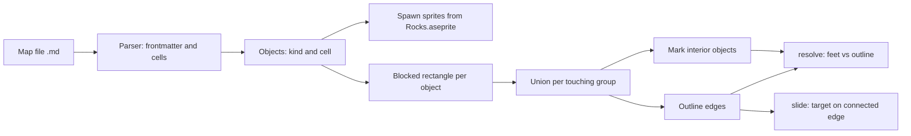

# Plan: rock clusters (then forests) with map files

Status: planning. No code is written. Four small decisions are open (section 8).
Updated: 2026-11-01. Related: roadmap item 1, `adr-lw1` (blocked band), `adr-lw4` (`allow_sliding`), `adr-lw7` (real-time RPG), `adr-lw8` (maps and rocks), roadmap item 3 (extract collision).

## 1. Goal

1. A human describes a cluster of rocks in a markdown file. The game builds the rocks and their collision from it.
2. Rocks are solid. Guy can only walk around the outside of a cluster, and he slides around its edges as he does for a tree trunk today.
3. Trees and forests later use the same map format and the same outline collision.

Long Way is a real-time top-down RPG (`adr-lw7`). Movement and sliding use frame time. NPCs and pathfinding are expected later.

## 2. Decisions already made

| Topic                   | Decision                                                                                                                                    |
| ----------------------- | ------------------------------------------------------------------------------------------------------------------------------------------- |
| Game type               | Real-time top-down RPG, not turn-based, not grid-locked (`adr-lw7`)                                                                         |
| First shape             | Rocks before trees. `Rocks.aseprite` exists: 128x128, two frames, tags `rock_0` and `rock_1`                                                |
| Rock behaviour          | Solid on all sides. No walk-behind part. Walk around the outline only                                                                       |
| Rock size               | 2x2 cells, 128 pixels                                                                                                                       |
| Rock collision          | Rectangle inset 10% on the left, right and top of the 128 pixel footprint, no inset at the bottom                                                                                 |
| Vertical margin         | 0 above and below the inset rectangle (decision 1, agreed)                                                                                  |
| Drawn look              | Rocks are drawn slightly overlapping, like shrubs in a top-down RPG. Collision does not follow the overlap, it stays on the inset footprint |
| Layout                  | Paint cells as text in a markdown file with frontmatter                                                                                     |
| Map cell (0, 0)         | Fixed world position `MAP_ORIGIN` = (-1024, -576), the F2 grid uses it too, so cells do not move when the window is resized                 |
| Placement, slide range  | Not decided. Experiment first (sections 5 and 6)                                                                                            |
| Loader and parser       | `include_str!` and an own parser for now. A more robust approach is on the roadmap (item 6)                                                 |
| Scope of this iteration | Includes the primitive map-making (parse file, place objects, collision), not only collision                                                |

## 3. What the code does today

From `games/long-way/src/collision.rs`, `trees.rs`, `debug.rs`:

- Each `Trunk` has a blocked rectangle for Guy's **feet**. Guy's body width (20 each side) is already added, so the feet are one point.
- `resolve` tests every trunk, one axis at a time. `move_feet` slides Guy along one rectangle face only, with a 0.2 second delay and a 35% range rule.
- Draw order uses the feet line (`depth.rs`), so overlapping sprites already sort.
- The F2 grid numbers cells from the bottom left, 64 pixels each. Map files use the same cell numbers.

## 4. Rock geometry

- Footprint: 2x2 cells = 128 x 128. Inset 10% each side: 102.4 x 102.4.
- Blocked area for the feet: the inset rectangle grown sideways by Guy's half width (20). Result 142.4 wide.
- Two rocks whose blocked areas touch or overlap join into one cluster. Rocks 3 or more cells apart leave a gap of about 50 pixels that Guy can walk through, so they are separate clusters.
- Everything inside a cluster is unreachable, so interior rocks need no collision test.

The vertical margin is 0: the blocked area ends at the inset rectangle above and below. Rocks sort by the bottom of the blocked area plus 1 (`SORT_BIAS`), not by the bottom of the footprint. With the footprint bottom, Guy standing at the blocked bottom (then 12.8 above the footprint bottom, now 0) was drawn behind the rock and looked as if he had walked in. Found by the developer on 2026-11-01. Guy standing below a rock has his upper body over the lower part of the sprite, as with trees.

### Drawn overlap (facts from the art)

- `rock_0.png` and `rock_1.png` are 32x32 pixel art scaled 8x to 256x256. Checked: every 8x8 block is one colour.
- The opaque part of the rock is 232 x 208 of 256 (x 8 to 239, y 16 to 223): 90.6% of the width and 81% of the height.
- Our `Rocks.aseprite` is 128x128, so one art pixel is 4 screen pixels. The rock is about 116 wide. At a pitch of 2 cells (128) two neighbours do **not** touch: 12 pixels of gap.
- To overlap slightly at a pitch of 2 cells, draw the rock larger than its footprint. 160 pixels is exactly 5x the art, so pixels stay even. The rock is then about 145 wide and neighbours overlap by about 17 pixels (about 12%). 192 pixels (6x) overlaps by about 46 pixels.
- `Rocks.aseprite` is therefore kept at the native 32x32 and scaled in the engine by `draw / 32`, which must be a whole number (4 = 128, 5 = 160, 6 = 192). Pixels stay even. Stretching a 128 pixel file to 160 would not (4x to 5x).
- Drawing larger than the footprint does not change collision. The inset footprints are 25.6 apart at a pitch of 2 cells, and Guy's 20 pixel margin each side closes that gap, so the blocked areas join and a cluster has no gaps.

## 5. The map file (human interface)

File location: `games/long-way/assets/maps/<name>.md`. The body is ordinary markdown, so a human can write notes, headings and sketches around the maps. The game reads the frontmatter, the `# Features` section and the `# Map` section (format decided 2026-11-01, replacing the first format where each `cells` block had its own `at=x,y`).

````markdown
---
map: rocks-test
cell: 64
origin: bottom-left
legend:
  ".": empty
  "0": rock_0
  "1": rock_1
---

# Features

Describes every feature that can be drawn.

## Rocks test

Notes about the feature, then its `cells` block.

```cells
. . 1 1 . .
. 0 0 1 1 .
. 0 0 . . .
. . 0 0 . .
```

## Reusable cluster

```cells
. 0 0 .
0 1 1 0
. 0 0 .
```

# Map

Places the features. Positions are in parentheses.

- 'Rocks test' at (21,9)
- 'Reusable cluster' at (2,12), (2,3) and (6,3)
````

Rules:

1. **Frontmatter.** `map` is a name for log messages. `cell` is the cell size in pixels (64). `origin: bottom-left` says cell (0, 0) is the bottom left cell, as in the F2 grid. `legend` maps one character to an object kind. `.` is always empty. Kinds are defined in code (`rock_0`, `rock_1` now, trees later). Optional keys: `pitch`, `draw`, `jitter`.
2. **Features.** Under `# Features`, each `## Name` heading defines one feature. It has one fenced `cells` block, with free text around it. Rows are written top to bottom, so the first row has the highest y. Characters are separated by spaces. The bottom left character is the anchor of the feature. A `cells` block takes no options.
3. **Map.** Under `# Map`, each bullet (`-` or `*`) is `'Feature name' at (x,y), (x,y) and (x,y)`. The name is in single or double quotes and must match a `##` heading exactly. Each position is the cell of the feature's anchor, in the F2 grid numbers. Commas and `and` separate positions. Features may be defined before or after the `# Map` section. Other text in the section is ignored.
4. **Placement.** A character places one object whose **bottom left corner** is that cell. A rock covers 2x2 cells, so it extends one cell right and one cell up. Neighbouring characters overlap by one cell, which makes a pile. A solid 4 x 3 painted area gives a cluster of 5 x 4 cells.
5. **Errors.** Every mistake stops loading and names the file and line: an unknown character, a ragged row, a `cells` block outside a feature, two `cells` blocks in one feature, a feature with none, a duplicate feature name, an unknown feature in a bullet, and a bad position. A silent skip would hide layout mistakes.
6. **Check.** The F2 grid and the `screenshot:` script command let Claude and the human compare the file with the screen.

The example above gives 10 rocks and 24 more from the three copies.

### Format choices to confirm

- **Parser.** A small own parser for the flat frontmatter (`key: value`, plus the `legend` list) needs no dependency. `serde_yaml` is archived and unmaintained, so a YAML crate would be a poor base. Recommended: own parser, with the supported subset written in the file header and covered by tests.
- **Loading.** Recommended first: `include_str!` of the map file. Edit the file, rebuild (about 8 seconds), no loader code, safe on wasm. Later: a Bevy asset loader with hot reload.

### Placement (decided: V1)

Chosen on 2026-11-01 after comparing three variants on screen: **one character per cell (`pitch: 1`), rocks drawn at 128 px (`draw: 128`), no jitter**. A dense pile with 50% overlap and fine control of the cluster shape. The variants with a 2 cell pitch (regular boulders, with and without 8 px jitter) were dropped. `pitch`, `draw` and `jitter` stay as optional frontmatter keys with these defaults, because shrubs or other kinds may want a different look later. Size rule: `n` characters in a row cover `pitch * (n - 1) + 2` cells.

### Reusable clusters (step 9, done)

A cluster is a feature in the `# Features` section. Placing it more than once is one bullet with several positions, for example `- 'Reusable cluster' at (2,12), (2,3) and (6,3)`. Copies are ordinary objects, so overlapping copies merge in the outline, and `jitter` uses the world cell, so copies look slightly different if jitter is on. Mirroring or rotating a copy is not planned. The first step 9 format (`cells name=` templates and `place` blocks) was replaced by this one on 2026-11-01.

### Extending to trees

Each object kind has art, a footprint and a collision rule, defined once in code:

| Kind | Art | Footprint | Collision |
|---|---|---|---|
| `rock_0`, `rock_1` | `Rocks.aseprite` tag | 2x2 cells | solid, inset 10% |
| `green_tree`, `red_tree` | `Green tree.aseprite`, `Red tree.aseprite` (128x128, all frames loop) | 2x2 cells | trunk band (`adr-lw1`) |

The map file only names kinds. Adding a kind never changes the file format.

Step 9b (done 2026-11-01): the two trees are placed from the map file. `trees.rs` reads the map, spawns a `Trunk` and a sprite per tree object, and `rocks.rs` skips tree kinds. The trunk is at pixels 76 to 104 of the canvas, the base is the bottom of the footprint. The trees moved slightly: they are now on whole cells ((12,8) and (18,8)) and 34 pixels lower than the old fixed positions. Checked in the game: walking up into the green tree stops Guy at y -94 (base -64 minus 30) and walking down from above stops him at y -51.2 (base plus 12.8), as before.

## 6. Collision approaches (research summary)

All blocked areas are axis-aligned rectangles, so the union is a rectilinear shape (horizontal and vertical edges only). The axis based slide rule keeps working on edge segments. Merging also removes seams, where a diagonal move catches on the inner edge between two touching rectangles.

| | A neighbour aware | B boundary polygon | C computed union (+ D cull) | E occupancy grid | F distance field | G physics crate |
|---|---|---|---|---|---|---|
| What | Keep rectangles, slide along a run of touching ones | Hand drawn forest outline | Merge rectangles at startup, collide with the outline | Rasterise blocked areas to a fine grid | Distance field and normal | `avian2d` or `rapier` |
| Authoring effort | none | high | none (cells already painted) | none | none | medium |
| Fixes seams | no | yes | yes | yes | yes | yes |
| Slide along long edges | partly | yes | yes | yes | different rule | different rule |
| Runtime cost | O(objects) | O(edges) | O(edges), less with D | O(1) | O(1) | engine |
| New dependency | no | maybe | no for rectangles | no | no | yes |
| Works on wasm | yes | likely | yes | yes | yes | to check |
| Unit testable without Bevy | yes | yes | yes | yes | yes | harder |
| Feeds NPC navigation later | no | yes | yes | yes | no | engine |

- **D (cluster, then skip interior objects)** is the developer's second idea. It only saves work. It is cheap once C has the union, so it is a step inside C.
- **B** matters for non-rectangular shapes. The painted map already authors the shape, so B is not needed for rocks.
- **E** is a candidate later for NPC pathfinding, not for Guy's collision.
- **F and G** do not fit: the slide is a game rule (delay, nearest edge, range limit), and the 50% overlap rules are not normal box collision. Roadmap item 4 decides the physics question.
- The outline already includes Guy's width. The same grown shapes are what a navigation mesh or visibility graph for NPCs needs ("configuration space"), so the data can be reused.

**Recommendation: C with D**, using own rectilinear union code (coordinate compression: sort all x and y values, mark filled cells, trace the boundary). It is exact, about 60 lines, testable and has no dependency. Bring in `i_overlay` (9.1.0, union and offset, `f32` and `f64`) only for non-rectangular shapes. Its repository is tagged `wasm` and `no-std`, but a wasm build is not tested.



### What the move to a real-time RPG changes

The recommendation for **Guy's collision stays C with D**. The feet-point rule, the outline and the slide rule do not depend on turns. What changes is the design around it:

1. **Many moving entities.** NPCs and enemies will test the same outline. Store it as one static resource with a broad phase (a spatial hash of edges) once the edge count grows. Not needed for the first iteration.
2. **Dynamic obstacles.** Doors, pushable objects and destroyed rocks change the outline. Rebuild the affected cluster only, or keep dynamic obstacles in a separate list. Static clusters stay precomputed.
3. **Navigation.** NPCs need pathfinding. The grown outline is the configuration space a navigation mesh or visibility graph needs, so it should be a reusable data structure, not buried in `resolve`. Occupancy grid (E) or a nav mesh then becomes a separate system fed by the same map.
4. **Larger worlds.** One map file per area, and the union per chunk, not one global outline.
5. **Physics crate.** The question in roadmap item 4 weighs more (NPC against NPC, projectiles, knockback). It does not replace the feet-point rule for terrain.
6. **Time.** Everything already uses frame time, so no change.

### Real-time notes

- Steps are small per frame (300 units per second, about 5 per frame), so tunnelling is not a risk. `resolve` still stops a move at the first edge it crosses.
- NPCs will use `move_feet` as well. Testing every outline edge per entity is fine for dozens of entities. A spatial hash is the later fix if it is not (static objects are inserted once).
- The slide timer already uses `dt`, so no change is needed for real-time play.

### Slide design to settle

- **Range rule.** 35% of a long cluster edge is too far. Options: a cap of one cell (64 px) or 1.5 cells, or the distance to the nearest outline corner with the cap.
- **Give up distance.** Never slide past a limit, so Guy is not carried round a corner onto the next face.
- **Concave corners.** At an inside corner, slide away from the corner, never into it.
- **Push direction.** The assist stores signs, not floats (`adr-lw5`). A merged face has one direction, so this stays.

## 7. Steps

1. **Map parser (done 2026-11-01).** Plain functions with unit tests: frontmatter, legend, cell blocks, errors with file and line. A first map file `assets/maps/rocks-test.md`.
2. **Spawn rocks from the map (done 2026-11-01).** Sprites from `Rocks.aseprite` (variant by tag), `DepthSort`, placed from cell numbers, with the `pitch`, `draw` and `jitter` knobs. Compared three variants on screen next to the F2 grid; the developer chose V1.
3. **Failing tests for the outline (done 2026-11-01).** Two touching rectangles, an L shape, a notch, a gap just wide enough for Guy, a gap too narrow.
4. **Union and outline (done 2026-11-01)** in `outline.rs` (plain functions, only `Rect` from Bevy), by coordinate compression. 18 tests. The grid is built over all rectangles at once, so very large maps need chunking (roadmap item 6).
5. **`resolve` against the outline (done 2026-11-01).** `resolve` and `move_feet` take the outline edges from a `CollisionWorld` resource, to which trunks and the rock outline are added at startup. The 16 trunk tests pass with unchanged bodies. Edges know which ends are inward corners (`Edge::covers`), and positions within `TOLERANCE` (0.01) of an edge count as on it. Real-game check: Guy stops at every face, walks along walls, and cannot slip into the cluster. Open for step 6: sliding to the end of a face can leave Guy pinned in a dead end pocket (see the note there).
6. **Slide target on the connected outline edge (done 2026-11-01)**, with the range and give up rules: the range is the smaller of 35% of the face and a cap of 64 (`SLIDE_RANGE_CAP`). An end is used only if the way past it is open for 192 (`SLIDE_CLEARANCE`, three cells, more than the 128 deep notches between rocks), checked by walking a probe with `resolve`. That also refuses ends at inward corners and ends that lead into pockets. Found in step 5: pushing into the left face of the test cluster slides Guy to the face end at (376.8, 76.8), and walking on he is stopped in the pocket below the upper rock at the inward corner (440.8, 76.8). The slide should not pick an end that leads into a pocket narrower than the way round, or it should give up when the continued move is blocked at once.
7. **Interior rocks (D) (done 2026-11-01).** `outline::build` lists the interior members of each cluster (`Cluster::interior`): members whose cells touch no empty space. Rocks get an `InteriorRock` marker for the step 8 overlay. This is a flag, not a speed-up: collision uses only the outline edges, so interior rocks already cost nothing. The plan said "culled objects change no result", but that is false for removing them from the input of `build`: an interior rectangle can be the only thing filling a hole, and a test shows the outline then changes. What the tests check instead: the flag matches a brute-force check (no edge lies on the rectangle) over 300 random layouts, plus fixed cases (3 by 3 block, 5 by 5 block, a plus shape, the hole case).
8. **Collision overlay (done 2026-11-01).** `collision_debug.rs` draws the overlay as sprites on the feature debug layer, and it turns on and off with F2 (F1 is gone, the gizmo overlay was removed). Yellow: every outline edge with a tick on the blocked side, trunks included. Cyan: the blocked area of each interior rock. Green squares: the feet of every depth-sorted entity. The red trunk boxes were dropped, the yellow outline covers them. Checked on screen with a screenshot. Also added compile-time checks for the layer order and the depth range.

9. **Reusable clusters (done 2026-11-01).** First built as `cells name=` templates and `place` blocks. The developer then chose a clearer file layout (section 5): a `# Features` section with one `## Name` heading and `cells` block per feature, and a `# Map` section with bullets like `- 'Reusable cluster' at (2,12), (2,3) and (6,3)`. `map.rs` parses that format (`parse_body`) with errors that name the line, and 34 tests cover it. `rocks-test.md` uses it. Checked in the game: same result as before (34 objects, 5 clusters, 54 edges).
9b. **Trees from the map (done 2026-11-01).** `green_tree` and `red_tree` are map kinds. The two trees are features ('Green tree', 'Red tree') placed in `# Map`. See section 5, "Extending to trees".

10. **Check in the real game (done 2026-11-01)** with `script` and `screenshot:`. Results (world coordinates, Guy walking up unless stated): middle of the 206 px bottom face of the main cluster, no slide (stays at 545, 0). From x 630, near the right end, slides right and walks up to y 128. From x 463, 480 and 520 under the left end: 463 and 480 slide into the notch and stop at (440.3, 64), 520 is beyond the 64 px cap and stays at y 0. Between two single rocks 3 cells apart (new 'Single rock' feature at (24,2) and (27,2)), Guy walks through the 49.6 px gap. Under the green tree from x -195, slides to the trunk end and walks on to the top of the view. Tree from above stops at -51.2 and from below at -94. Not seen: depth order checked only in two screenshots (Guy behind and in front of the green tree) at normal size, not zoomed, and no flicker check with the map rocks; slide past a corner of the lower left patches and a tree touching a rock were not run.
11. `lint`, `test`, `web`.
12. **Record (done 2026-11-01).** `adr-lw1` to `adr-lw11` cover the decisions (new: `adr-lw10` slides, `adr-lw11` map layout). `BEVY-ADDITIONS.md` has the collision and sliding rules, the collision debug overlay and the markdown map files. `bevy-notes.md` has the gizmo and sprite overlay note and the ordering notes. `BEVY-CONCEPTS.md` has the collision and project layout updates. `art-tags.md` lists the map kinds. Roadmap item 3 lists what blocks the split of `collision.rs`. Roadmap item 1 moves to Completed in step 13.
13. **Migrate lasting content** from this plan into long-lived docs (a user guide for map files in `docs/`, decisions in `dev-docs/adr/`), then delete this file. Ask the developer before the commit.

## 8. Open decisions

1. **Vertical margin:** decided, 0. Rocks are drawn slightly overlapping (section 4).
2. **Placement meaning:** decided, V1 (section 5).
3. **Slide range** on long edges: first values are in (cap 64, clearance 192), to be tuned by playing. The other options (96 px, nearest corner) were not built. Try a 64 px cap, a 96 px cap and the nearest corner with a cap, using scripted runs and the slide log lines. Keep the three behind one constant or function while testing.
4. **Loading and parser:** decided for now: `include_str!` and an own parser. A more robust approach is roadmap item 6.

## 9. Sources

- [Greedy merging of tile maps into collision rectangles (Feronato)](https://emanueleferonato.com/?p=15637) and [gamedev.net copy](https://gamedev.net/news/2165-reducing-tiled-maps-to-optimized-collision-rectangles-with-greedy-merging/): grid to few rectangles, a one time pass, removes seams.
- [FlatRedBall merged collision](https://docs.flatredball.com/flatredball/tiled-plugin/glue-gluevault-component-pages-tile-graphics-plugin-tileshapecollection/addmergedcollisionfromtileswithproperty): merges adjacent rectangles by row or column.
- [Unity CompositeCollider2D](https://docs.unity3d.com/ja/560/ScriptReference/CompositeCollider2D.html): merges box and polygon colliders into one outline.
- [Defold forum: top-down static colliders](https://forum.defold.com/t/what-is-the-best-way-to-set-up-collisions-in-static-sprite-based-2d-games-with-a-top-down-view/73757): concave shapes need care.
- [Construct forum: many trees](https://construct.net/en/forum/construct-2/general-discussion-17/lighter-collision-element-98453): collider on the base only, plus spatial partitioning.
- [i_overlay (docs.rs source)](https://docs.rs/crate/i_overlay/latest/source) and [repository](https://github.com/iShape-Rust/iOverlay): union, difference, offset, float and integer points.
- [Adrien Bon, bevy_ecs_tiled physics guide](https://adrien-bon.github.io/bevy_ecs_tiled/guides/physics.html): colliders from Tiled object layers. A later option for maps.
- [Obstacle inflation and Minkowski sum, MIT 6.141 CSpace](https://courses.csail.mit.edu/6.141/spring2013/pub/labs/lab6/docs/javadoc/GlobalNavigation/CSpace.html): grow obstacles by the agent radius so the agent is a point.
- [Godot, using CharacterBody2D](https://docs.godotengine.org/ja/4.5/_sources/tutorials/physics/using_character_body_2d.rst.txt): `move_and_slide` collide and slide.
- [Spatial hash broad phase (Bonk docs)](https://gitea.moonside.games/MoonsideGames/bonk-docs/src/branch/main/content/broad_phase/spatial_hash.md): static objects inserted once.

Not verified: `i_overlay` building for `wasm32-unknown-unknown`, and that `serde_yaml` is archived (from memory, check before relying on it).
