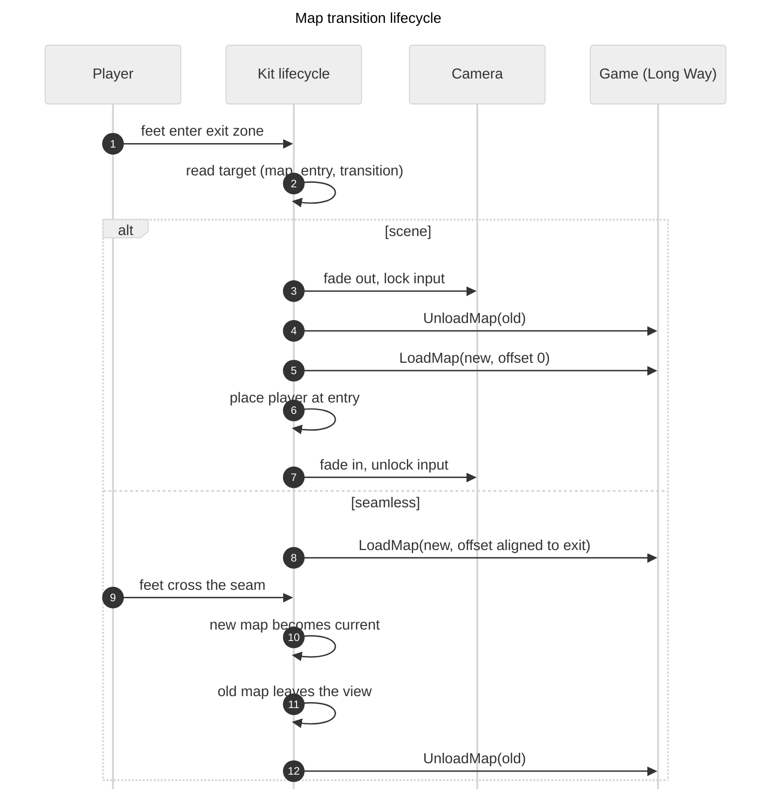

# PLAN: Move between maps (Long Way, game-kit)

Status: draft for review. Implementation steps are in section 7. Date: 2026-11-06.

## 1. Goal

A game registers several maps. The player walks into an exit zone on one map and arrives at an entry point on another. The kit runs the whole lifecycle. Two camera styles:

- **Seamless.** The player walks from one map into the next. Both maps are in the world at the same time.
- **Scene.** The screen fades out, the new map loads, the screen fades in. Like a new stage in a platformer.

Long Way is the first user. Maps `1.txt` (start), `2.txt` and `3.txt` exist (2 and 3 are empty, same legend as 1). The map graph: 1 leads to 2 and to 3, 2 leads to 3. Map 1 has two exits and the player start. Map 2 has an entry and an exit. Map 3 has two entries (from 1 and from 2).

Evidence labels: **[web]** found by web search in this session. **[memory]** general knowledge, not checked. **[code]** read in this repo.

## 2. Research: how other engines do it

| Engine / tool | Approach | Notes |
|---|---|---|
| Godot | One scene per level. A door is an `Area2D` with a target scene path. An autoload "scene manager" swaps the scene. The spawn point is a name or a marker node in the new scene. [web] [door and autoload advice](https://forum.godotengine.org/t/the-problem-with-switching-between-scenes/103861), [spawn point thread](https://forum.godotengine.org/t/character-spawn-point-when-changing-scenes/102194) | Keep the player in its own scene and move it between levels. [web] [RPG transitions thread](https://forum.godotengine.org/t/whats-the-best-way-to-do-rpg-transitions-in-godot/55194). Use threaded loading for large scenes. [web] Keep cross-level state in an autoload. [web] |
| Zelda-style rooms (Godot, Unity, GameMaker) | An edge trigger moves the player into the next room. The camera pans to the new room's fixed position. Per-room camera limits are the hard part. [web] [camera limits thread](https://godotforums.org/d/30910-how-to-setup-a-camera-confinder-for-a-zelda-like-room-transition) | Gameplay is usually paused during the pan. [memory] |
| LDtk with `bevy_ecs_ldtk` | Levels sit at positions in one world. A `LevelSet` or `LevelSelection` chooses which levels are spawned, so neighbours can be loaded together. [web] [docs.rs](https://docs.rs/crate/bevy_ecs_ldtk/latest/source/src/components/level_set.rs) | This is the model for seamless maps: each map has a world offset. Portals carry data as entity fields. [memory] |
| Tiled and RPG Maker | A warp object or event has properties: target map, target spawn name or x,y, facing, fade. [memory] | This is the model for scene transitions and for the data in the map file. |
| Unity | Additive scene loading for streaming. A camera confiner (Cinemachine) is swapped per room. [memory] [camera confiner mentioned in thread](https://godotforums.org/d/30910-how-to-setup-a-camera-confinder-for-a-zelda-like-room-transition) | Same split: additive for seamless, single load for a scene change. |
| Unreal | Level streaming volumes and World Partition load and unload sublevels by distance. [memory] | Heavy for this project. The idea to keep: unload when the player is far enough away, not at the seam. |
| Bevy | No built-in map transition. `States` plus state-scoped entities (`DespawnOnExit`) give a clean unload. [code] `bevy-src/crates/bevy_state/src/state_scoped.rs` | We write the lifecycle ourselves. |

### What all of them share

1. A **trigger** in the old map (area, edge, door).
2. A **target**: map id and an entry name. The new map owns where the player stands.
3. A **lifecycle** with fixed steps: lock input, transition out, unload, load, place the player, transition in, unlock.
4. **Entities that survive** (the player, the camera) are kept out of the unload.
5. Some form of **per-map camera limits**.

## 3. What the code does today [code]

- `games/long-way/src/map.rs` loads one map with `include_str!("../assets/maps/1.txt")`. `CurrentMap` is a resource with one `Map`. `reload_map` (F1) despawns every `MapEntity`, spawns rocks, trees and the player again, and rebuilds collision.
- Every object in a map blocks (`blocking_groups`). A marker object would block unless we exclude it.
- `camera.rs` has one fixed `MAP_ORIGIN` and `map_rect(size)`. All maps would sit at the same place today.
- `CameraBounds` (kit) is one `Rect`. `follow_position` clamps the camera to it.
- `CollisionWorld` is one global set of areas in world units, rebuilt from `Blocker` components with `register_blockers`. Two maps in the world at once work if both maps' blockers are in world space.
- The F3 grid (`DebugPlugin`, `GridOrigin::World(MAP_ORIGIN)`) draws one grid from one origin.
- The map format already supports markers (`"@": player_start`) and legend parameters (`"S": spawn_skeleton every=10`). Cells are one object per cell. No layers. Roadmap items 3 and 4 say to decide the map pipeline "when the second map appears". This is that point.

## 4. Proposed design

### 4.1 Map file: exits and entries

Exits and entries are blocks in the front matter, like `legend`. This needs a parser change in `game_kit::map` (a second and third nested block). The grid characters stay free for blocking sprites.

```
exits:
  to_2: area=3..6,9 to=2 entry=from_1 transition=seamless
entries:
  from_1: area=3..6,0
```

- `exits:` and `entries:` each hold one line per item: a name, then `key=value` pairs (same style as legend parameters). Names are unique per map.
- **`area=x0..x1,y` or `area=x,y0..y1`** is a straight strip of cells: a range on one axis and one fixed value on the other. A strip can never be diagonal or a block, and only the strip along an edge is needed. Cells are numbered like the row labels of the file: a `top-left` file counts rows from the top. The parser converts them to cells from the bottom left. One cell is `area=4,0` (an entry for a scene transition is usually one cell).
- An **exit** has `area`, `to` (map id), `entry` (entry name in that map) and `transition=seamless|scene`. Its area must touch a map edge. The edge it touches gives the direction of travel.
- An **entry** has `area` and an optional `facing=up|down|left|right`. **The player keeps their position along the strip.** The offset from the start cell of the exit (in world units, measured from the low end: x for a strip on the top or bottom edge, y for a strip on the left or right edge) is added to the start of the entry strip, and the player is placed in the middle of the strip's depth (one cell). When the exit and the entry are on different kinds of edge (an exit on the right edge and an entry on the bottom edge), the offset moves from the y axis to the x axis. The low end stays the low end (see "Entry placement" in step 7). Every exit and its entry must have the same length, for scene as well as seamless transitions, so the offset always fits. A seamless transition needs an area on a map edge with the same length as the exit it joins.
- **Convention in the grid:** the cells of an exit or entry area are written with a blank (`' '`), not `.`. A reader then sees the zone in the drawing. The parser treats blank and `.` the same (rule 12 of the format), so this is a reading aid. The parser does check that an `area` holds no object, and reports the line of the exit.
- **Player start** is not an entry. It stays a `player_start` marker in the grid, as in R-Town (`"@": player_start`, `games/r-town/src/map.rs`). The kit has no start concept. A map that is only entered from another map has no `player_start`. Map 1 has one.
- **Convention: `player_start` in any map you want to start in directly.** Map 1 has the real start. A later map (for example `2.txt`, at the cell of its entry) also gets an `@`. The game then starts there when the scripted run or a dev launch names that map, so a transition target can be tested and screenshotted alone (`script long-way "..." --debug`). In a normal run the marker in a later map is not used, because the player is placed at the entry. The marker may sit on an entry cell, so the "no object in an area" check allows `player_start` in an entry area. It does not allow it in an exit area (the player would start inside the exit).
- Load-time checks, with file and line: an area that is outside the map or does not touch an edge (exit), an object inside an area, an unknown `to` map, an unknown `entry` in the target map, and for seamless a length mismatch between exit and entry.
- Map graph for Long Way: 1 to 2 (exit `to_2`, entry `from_1`), 1 to 3 (exit `to_3`, entry `from_1` in map 3) and 2 to 3 (exit `to_3`, entry `from_2` in map 3). Entry names are per map. All exits are `transition=scene` for now, because every exit area is wider than its entry. No exit goes back, so there is no return trip yet.
- The three map files stay on the same legend for the existing kinds. The `exits:` and `entries:` blocks are the only addition.

### 4.2 Kit: registry and lifecycle

New kit module `map_transition.rs` (name open). Parts:

- **`MapRegistry`** (resource): map id to source. The game registers each map with `id` and the bundled text (`include_str!`). A native run reads the file from disk instead, so F1 keeps working (same rule as today). The web build uses the bundled text. Maps are tiny, so the registry parses them all at start and reports errors early. No async loader needed.
- **`ActiveMaps`** (resource): the maps that are in the world now, each with `id`, `Map` and a `world_offset`. The "current" map is the one that holds the player's feet.
- **`MapId(String)`** component on every entity a map spawns. This replaces the single `MapEntity` marker, so one map can be removed while the other stays.
- **Messages** (kit to game, so the kit has no game types):
  - `MapExitEntered { from, exit }` (kit detects it)
  - `LoadMap { id, offset }` (game spawns rocks, trees and so on, tagged with `MapId`)
  - `UnloadMap { id }` (kit despawns by `MapId`, then rebuilds collision from the remaining blockers)
  - `MapReady { id }`
- **Phase** as a Bevy `SubState` (CLAUDE.md default): `Idle`, `FadeOut`, `Switching`, `FadeIn`. Seamless uses `Idle` and `Streaming` only.
- **Exit detection**: a system tests the `Controlled` entity's feet point against each exit rectangle of the current map. It fires once and is blocked until the player has left every exit zone.
- **Input lock**: a `TransitionLock` resource that player movement checks (`run_if`). Scene transitions set it. Seamless does not.



### 4.3 Camera style 1: seamless

- **Placement.** The new map is put at a world offset so its entry strip lines up with the exit strip. A map joined at the top edge goes above, and so on. This is the LDtk world-layout model.
- **Both maps are live.** Their objects, blockers and depth sort share one world space. `CollisionWorld` is rebuilt from all `Blocker` components of the active maps. Because collision is already in world units [code], clusters across the seam merge with no extra work.
- **Current map** switches when the feet cross the seam.
- **Unload** happens when the old map's rectangle is outside the camera's visible rectangle (`visible_rect` exists in `camera.rs`), not at the seam. The view is 8 cells and a map is 10, so the old map is still on screen after the seam.
- **Camera bounds.** Today it is one rectangle. Options:
  - A. Bounds are the bounding box of all active maps. The bounds grow in one frame when the new map loads, so a camera that was held at the old edge jumps. The box can also include empty space.
  - B. Bounds are the current map only. The camera jumps when the current map switches.
  - **C (chosen).** Bounds are the bounding box of the active maps, and the camera bounds ease from the old rectangle to the new one over a short time when the set changes (a load, or an unload). The follow position is clamped to the eased rectangle, so the camera never jumps. `CameraBounds` gets a target rectangle and a current rectangle, and a system moves the current one towards the target.
- **Debug grid and info box.** These must change (chosen): draw a grid for each active map from that map's own origin (`GridOrigin` becomes a list), label cells in the local numbers of the map they belong to, and show the map id with the cell in the F2 box. The scripted run and `shot.sh` use world units, so they keep working.
- **Constraints, checked at load:** the entry and exit strips have the same length, the exit is on the edge, and two maps that are active together must not overlap in world space.
- **Limit:** maps linked this way must form a layout that fits in the plane. Map 2 and map 3 cannot both join the same edge of map 1 at the same place.

### 4.4 Camera style 2: scene transition

- A full-screen overlay (a UI node or a sprite on the top layer in `layers.rs`; no bare z values) fades to a colour and back. The kit owns the overlay.
- The swap is done in one frame while the screen is fully covered. No streaming, no offsets: the new map is always at offset 0 (same `MAP_ORIGIN`).
- The camera is moved to the player at the entry before the fade in, so it never pans.
- Style is a small enum: `Fade { colour, out_secs, in_secs }` first. `Wipe` and `Slide` (a Zelda pan) can be added later without a lifecycle change.
- Gameplay is paused during the fade (`TransitionLock`; timers use `time.delta_secs()`).

### 4.5 Which style is used

Per exit, in the map file: `transition=seamless` or `transition=scene`. All current exits are `scene` (an exit area wider than a one-cell entry cannot join seamlessly). To test seamless, give one exit and its entry the same length. Two maps that are seamless-joined to the same map must not overlap in world space (map 3 is reached from both 1 and 2, so at most one of those links can be seamless unless the layout fits).

An entry must not be inside an exit zone of its own map, or the player would bounce back at once. Load-time check, plus the "once, until the player leaves all exits" rule in 4.2.

### 4.6 Long Way changes

- `MapPlugin` registers the three maps and stops owning one `CurrentMap`.
- `spawn_rocks`, `spawn_trees` and `spawn_player` take a map and an offset. The player spawns once, at the `player_start` marker of map 1 (as R-Town does), not at the hard-coded bottom middle. It is not tagged with a map id, so it survives transitions. `blocking_groups` skips the `player_start` marker.
- `camera.rs`: `map_rect` takes the offset. `MAP_ORIGIN` becomes the origin of the first map.
- F1 reloads the current map only and keeps the player's position.
- Dev launch: the game start map is chosen by an environment variable (for example `LONG_WAY_MAP=2`, same pattern as `<GAME>_MAP`) and the player spawns at that map's `player_start`. The scripted run uses it.
- Script runner: add commands `goto:<map>:<entry>` and `wait_map` so a scripted run can test a transition and take screenshots (`adr-x5`).

## 5. Decisions

Made:

1. Exits and entries go in the front matter (`exits:`, `entries:`). Areas are marked with blanks in the grid by convention. Exit areas touch a map edge and are usually wider than one cell.
2. Camera bounds in seamless mode: the bounding box of the active maps, eased when the set changes (option C).
3. Debug grid: one grid per active map, with local labels.
4. `MapRegistry` and the lifecycle live in a new kit module `map_transition.rs`.
5. The map graph: 1 to 2, 1 to 3 and 2 to 3. No return exits yet.
6. The player start is a `player_start` marker in map 1, as in R-Town.
7. Maps stay on our own parser and `include_str!` behind `MapRegistry`. See section 6 for the Bevy asset loader trade-off. The user may still choose it.
8. Per-map state is out of scope now. See the consideration below.

### Consideration for the long-lasting docs: returning to a previous map

This plan does not solve it. Write it into `dev-docs/extensions/map-transitions.md` when the plan is migrated. The questions:

- What state does a map keep when the player leaves and comes back (a destroyed rock, an opened door, a killed enemy)? Today a map is rebuilt from its file on every load, so it comes back as authored.
- Options: always reset (simple, fits a platformer stage); keep a per-map state record in a resource keyed by map id and apply it when the map loads; or save per-map state only for objects marked as persistent.
- Where does the player appear on return? At the named entry of the exit used. With no return exits, this cannot happen yet. When return exits are added, each exit needs a matching entry in the other map.
- In seamless mode a map that is unloaded and loaded again must give the same result at the seam.
- Enemies that follow the player across a seam, and projectiles in flight across a transition, are not handled.

## 6. Risks

- **Seamless is the larger change.** It touches spawning, collision rebuild, depth sort, camera bounds and the debug tools. Scene transitions touch far less. Build scene transitions first, then seamless, on the same lifecycle.
- **Cluster merge across the seam.** Rocks and trees near the seam can join into one cluster and change the one-cell tree rule (`adr-lw18`). Needs a scripted run to see it.
- **Collision rebuild cost** on every load or unload. Fine at this size. Re-check if maps grow (roadmap item 3).
- **Web build.** Everything stays plain Rust and `include_str!`. No new dependency.
- **Parser change.** `exits:` and `entries:` are new nested front matter blocks in `game_kit::map`. R-Town's maps must still parse with no change (blocks are optional). Tests in the kit cover both.
- **Bevy asset loader (not chosen now).** Benefits: a map is fetched over HTTP on the web build, so the wasm file is smaller and a map edit needs no rebuild; hot reload on native through the asset watcher; neighbour maps can be preloaded in the background for seamless links; load state fits `bevy_asset_loader` loading states. Costs: a custom `AssetLoader` for our parser, a map is not ready on the frame you ask for it (the lifecycle needs a wait state), and errors arrive as asset events. Maps here are tiny, so load time is no gain. `MapRegistry` hides where the text comes from, so the switch later changes only the registry. Decide with roadmap item 3.

## 7. Implementation steps

Order: scene transitions first, then seamless, on one lifecycle. Each step ends with `./dev-scripts/rust.sh lint` and, for `game-kit`, `./dev-scripts/rust.sh test game-kit`. Run `./dev-scripts/rust.sh size` before the first build. Run `./dev-scripts/rust.sh web` after steps 4 and 11. Per CLAUDE.md, behaviour that must work in the real game is first reproduced with `./dev-scripts/rust.sh script long-way "..." --debug`, with a failing test written for the cause. Claude says what it did not see on screen. Commits are listed as steps. Claude asks before each one and does not push.

### Phase A: the map file

1. **Parser: `exits:` and `entries:` blocks** (`crates/game-kit/src/map.rs`).
   - Add `Area` (a cell rectangle), `MapExit { name, area, to, entry, transition }`, `MapEntry { name, area, facing }`, and `Transition { Seamless, Scene }`. `Map` gets `exits` and `entries`. Both are empty when the blocks are absent, so R-Town's maps parse as before.
   - Parse `area=x0..x1,y`, `area=x,y0..y1` and `area=x,y`. Reject a range on both axes, and a range with the start above the end. Cells are numbered like the row labels of the file, and the parser converts them to the bottom left (a `top-left` file counts rows from the top). **Done:** `crates/game-kit/src/map_areas.rs`, 25 tests.
   - In-map checks with the file and line: area inside the map, exit area touches an edge, names unique per block, known `transition` and `facing` values, no object inside an area (an entry area may hold `player_start`, an exit area may not), missing or repeated keys.
   - Kit tests: each rule above, both origins, an unchanged R-Town-style file, the three Long Way map shapes.
2. **Links between maps** (`map.rs` or a new `map_links.rs`): `validate_links(&[Map])` checks that `to` names a registered map, that `entry` exists in that map, and that an exit and its entry have the same length (every transition, not only seamless). Pure function, kit tests. The error names the file and the exit line. A seamless exit also needs its entry on the opposite edge (a top exit joins a bottom entry), and may not lead to its own map. **Done:** `crates/game-kit/src/map_links.rs` (`validate_links(&[LinkedMap])`, 12 tests).
3. **Long Way reads the new files** (`games/long-way/src/map.rs`). **Done 2026-11-06:** scripted run on map 1 shows the player at cell (4,0), feet at (-736,-544).
   - Add `player_start` to `KIND_NAMES` and `Kind`, and skip it in spawning and in `blocking_groups`.
   - Spawn the player at the `player_start` of map 1, not at the bottom middle.
   - The game still loads only `1.txt`. Check with a scripted run and a screenshot that map 1 looks as before and the player starts at (4,0).
4. **Record the decision (done 2026-11-06: adr-x30, adr-lw19)** in `dev-docs/adr/EXTENSIONS.md` (exits and entries in front matter, grid areas written with blanks, `player_start` convention). Update `dev-docs/extensions/map-files.md`, `games/long-way/docs/maps.md` and roadmap item 4. Ask the user about a commit.

### Phase B: registry and scene transition (done 2026-11-06)

5. **Registry and map ids (done)** (new `crates/game-kit/src/map_transition.rs`, plus `lib.rs`).
   - `MapRegistry` (id to parsed `Map`, with `register(id, name, source)`; native reads the file from disk, web uses the bundled text), `ActiveMaps` (id, `Map`, `world_offset`), the `MapId` component, and the messages `LoadMap`, `UnloadMap` and `MapReady`. Run `validate_links` when the registry is built.
   - Long Way registers `1.txt`, `2.txt` and `3.txt` with `include_str!`. `MapEntity` becomes `MapId`. `spawn_rocks`, `spawn_trees` and `spawn_player` take a map and an offset. `camera.rs` `map_rect` takes the offset. F1 reloads the current map only.
   - Behaviour stays the same with one active map. Check with a scripted run on map 1. Run `./dev-scripts/rust.sh web`.
6. **Dev launch (done: the start map is the file in `LONG_WAY_MAP`, set by `rust.sh run long-way 2.txt` or `rust.sh script long-way "..." 2.txt`)** (`LONG_WAY_MAP=<id>`, `<GAME>_MAP` pattern): the game starts in that map at its `player_start`. Add `@` to `3.txt` if the user wants to start there. Scripted run starts in map 2 and takes a screenshot.
7. **Scene lifecycle (done, with the fade of step 8)**
   - Add a `MapPhase` sub-state (`Idle`, `FadeOut`, `Switching`, `FadeIn`), `TransitionLock`, and the exit detection system (feet point inside an exit area of the current map, fires once, rearms when the feet leave every exit area).
   - On a scene exit: lock, `UnloadMap`, `LoadMap` at offset 0, place the player in the entry strip at the same offset along the strip as where they left the exit, with the entry's `facing`, unlock. **Entry placement** is a pure function `entry_position(exit, exit_feet, entry)` with kit tests for every pair of edges (4 by 4). Offset = feet coordinate along the exit strip minus the strip start. The result = entry strip start plus that offset along the entry strip, and the middle of the strip's depth across it. Same kind of edge: the offset carries over unchanged. Different kind (horizontal strip to vertical strip or the reverse): the offset moves to the other axis and the low end stays the low end. The player entity is kept. Player movement and the shot systems check the lock.
   - Write a failing test for the pure parts first (feet in area, fire once, entry placement). Add the `goto:<map>:<entry>` and `wait_map` script commands (`crates/game-kit/src/script.rs`, `adr-x5`).
   - Scripted runs with `--debug`: walk into `to_2`, `to_3` in map 1 and `to_3` in map 2. Screenshot before and after each. Check that the player does not bounce back at the entry.
8. **Fade (done)** A full-screen overlay on the top layer in `layers.rs` (no bare z values), `Fade { colour, out_secs, in_secs }`, input locked while it runs. The swap happens while the screen is fully covered. Scripted run with screenshots at the fade-out peak and after the fade-in.
9. **Debug info (done: the F2 box has a `map` row)** The F2 box shows the map id with the cell. Kit test for the label. Record the lifecycle decision in `dev-docs/adr/EXTENSIONS.md` and `games/long-way/docs/adr.md`. Ask the user about a commit.

### Phase C: seamless (done 2026-11-06)

10. **Test pair for seamless (done: `to_2` is seamless)**. The 1 to 2 link (`to_2` `area=3..6,9` to `from_1` `area=3..6,0`) is the pair: equal length, opposite edges. Set `transition=seamless` on `to_2` when Phase C starts (the user agreed).
11. **Offsets and layout (done)** (kit, pure functions). A seamless exit and its entry must have the same length (strict check, decided so a mistake in a map file shows as a clear load error). The offset along the edge is the exit start minus the entry start, so the two strips lie on top of each other and the strip is the doorway: world offset from an exit and an entry on each of the four edges, and the overlap check between active maps (`validate_layout`). Kit tests for every edge, strips of equal length, and overlap.
12. **Seamless lifecycle (done)**
    - On a seamless exit send `LoadMap` at the computed offset. Both maps are live. No lock and no fade.
    - Player clamp: `move_player` now clamps to one `map_rect`. With two live maps, the clamp is the union of the active map rectangles, and the player may cross a map edge only inside the doorway (the exit strip, which equals the entry strip). Everywhere else the edge stays a wall. Write a failing test for this first.
    - The current map switches when the feet cross the seam. `UnloadMap` runs when the old map's rectangle is outside `visible_rect`.
    - After each load or unload, rebuild `CollisionWorld` from all `Blocker` components of the active maps. Depth sort needs no change.
    - Scripted run: walk through the seam, screenshots before, at the seam, after the unload. Look at rocks and trees near the seam, and at the one-cell tree rule (`adr-lw18`).
13. **Eased camera bounds (done)** `CameraBounds` gets a target and a current rectangle. The target is the bounding box of the active maps. A system eases the current rectangle towards the target after a load or unload. Kit tests for the easing and the clamp. Scripted run with screenshots to confirm no jump.
14. **Debug grid per active map (done)** The F3 grid and cell labels draw for each active map from its own origin, with local numbers (`GridOrigin` takes a list or the debug plugin reads `ActiveMaps`). Check with `--debug` screenshots, and `./dev-scripts/shot.sh` at the seam. Run `./dev-scripts/rust.sh web`. Record the seamless decisions in the ADR files. Ask the user about a commit.

### Phase D: close

15. **Final check.** `./dev-scripts/rust.sh lint`, `test game-kit` and `web`. Run `./dev-scripts/rust.sh size` and delete `target/screenshots/`. Say what was not seen on screen.
16. **Migrate lasting content and delete this plan** (section 9). Ask the user about the last commit.

## 8. Test approach

- Kit unit tests (adr-w7): exit rectangles from cells, feet-in-zone, the "fire once" rule, offset alignment for each edge, overlap check, camera bounds, phase order.
- No game tests for the map files (adr-lw17).
- Scripted runs with `--debug`: walk into each exit, take screenshots before, during and after. Report what was not seen on screen.

## 9. Final step when done (step 16)

Migrate lasting content: the file format to `dev-docs/extensions/map-files.md` and `games/long-way/docs/maps.md`; the lifecycle to a new `dev-docs/extensions/map-transitions.md`; decisions to `dev-docs/adr/EXTENSIONS.md` and `games/long-way/docs/adr.md`; update roadmap items 3 and 4 and add a Completed item. Add any new Bevy concept (`SubStates`, state-scoped entities) to `dev-docs/bevy/concepts.md`. Delete this plan file.

## Changes made while building phase B

- The lifecycle runs the game through three one-shot system hooks (`load`, `rebuild`, `arrive`) and not through load and unload messages, because the order must be fixed inside one frame (`adr-x31`). The plan's `LoadMap`, `UnloadMap` and `MapReady` messages are not built.
- The phase is a resource (`MapTransition`), not a `SubState`, because the game has no app states yet.
- The game gets a `rebuild` hook that the plan did not list, because the collision world is rebuilt from the entities after every load.
- `goto:<map>:<entry>` waits until the transition is done, so there is no `wait_map` command.
- The start map comes from a map file name (`LONG_WAY_MAP`, the same pattern as R-Town's `R_TOWN_MAP`) and not from an id, so `rust.sh` can take it as an argument.
- Phase C step 12 (seamless) adds to the same lifecycle. The `rebuild` hook must then rebuild from all active maps, and `CameraBounds` moves from the kit's `install_map` to the eased bounding box.

## Changes made while building phase C

- A map that is out of view is removed after 1 second (`UNLOAD_AFTER_SECS`), not at once, because a map that was just loaded is out of view until the camera limits have eased.
- The player clamp is `clamp_to_union(areas, old_feet, new_feet)` over `ActiveMaps::walkable`. The first version took only the new position and could carry a long step through a wall into the nearer map. The old feet decide which areas count.
- `CameraBounds` stays the current limits that the camera reads, and a new resource `CameraBoundsTarget` holds where they are heading. The limits ease with a time constant of 0.35 s.
- The debug grid has a resource `DebugGrids` with one region per map, and does not take a list in `GridOrigin`. The lines and numbers of each map follow its own origin. The grid lines at the top and right edge of a map have no number.
- The camera shows the current map only, and not the box around both (changed after the first build, on request): the box includes the joined map only while the feet are in the exit, and after the crossing the camera moves on to the new map until the old one is out of view. The move is slow (`camera_ease_secs`, Long Way 0.9 s, a time constant). First the limits were eased, which gave a quick move, a stop and a slow move, because the camera follows the player instantly. Now the limits change at once and the camera eases out only the offset the change adds (`CameraSmoothing`), measured in a scripted run: one smooth glide that carries on after the player stops.
- The 1 to 2 exit is `seamless` in `1.txt`. The other two exits are `scene`.
- Seen in scripted runs: the walk through the seam with the grid of both maps and the info box on map 2, the wall beside the doorway (feet stop at y 14), the first map removed after the player went far enough into map 2 (the collision log goes from 4 clusters to 1), and the scene transitions after the change. Not seen on screen: the easing of the camera limits as an animation (it is unit tested), and rocks or trees that cross the seam (no object of maps 1 and 2 is near it).
