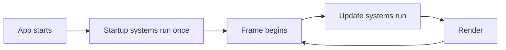

# Bevy concepts

How Bevy works, in plain terms, using this project's code as the examples. Written for someone who knows game engines but not Bevy. Version: Bevy 0.20.1.

This file explains Bevy only. Project code appears as examples, but design decisions do not belong here. Where they live:
- Short verified code snippets and pitfalls: `dev-docs/bevy/notes.md`.
- Our own reusable designs built on top of Bevy (collision, draw order, map files and others): `dev-docs/extensions/`.
- Source files and values of one game: `games/<game>/docs/`.

Sections marked **Not used yet** describe things Bevy offers that this project has not touched. They come from reading `bevy-src/`, not from running them here. Treat them as leads, not proven patterns.

## The big idea: ECS

Bevy has no "game object" class with behaviour. It uses an Entity Component System:

| Term | What it is | Example here |
|---|---|---|
| **Entity** | An ID. It has no data or behaviour of its own. | The player, the camera |
| **Component** | A plain piece of data attached to an entity. | `Player`, `Transform`, `Sprite` |
| **System** | A normal Rust function that reads and changes components. All behaviour lives here. | `move_player`, `animate_player` |
| **Resource** | One global value, not tied to an entity. | `Time`, `ButtonInput<KeyCode>`, `AssetServer` |

An entity is defined by which components it has. The player is "an entity with `Player`, `AseAnimation`, `Sprite` and `Transform`". There is no `Player` class. If you add a `Health` component to an entity, every system that asks for `Health` now sees it.

## App: the application shell

`App` is the whole game. `main.rs` builds one and runs it:

```rust
App::new()
    .add_plugins(DefaultPlugins.set(ImagePlugin::default_nearest()))
    .add_plugins(AsepriteUltraPlugin)
    .add_plugins((camera::CameraPlugin, player::PlayerPlugin))
    .run();
```

`run()` opens the window and starts the game loop. It does not return until the window closes.

## Plugins: how code is organised

A plugin is a bundle of setup: systems, resources and other plugins. Everything in Bevy is a plugin, including rendering and input. `DefaultPlugins` is the standard set (window, rendering, input, assets, logging).

Our own code follows the same pattern. One plugin per feature:

```rust
pub struct PlayerPlugin;

impl Plugin for PlayerPlugin {
    fn build(&self, app: &mut App) {
        app.add_systems(Startup, spawn_player)
            .add_systems(Update, (move_player, animate_player).chain());
    }
}
```

`.set(ImagePlugin::default_nearest())` changes one setting of a plugin inside `DefaultPlugins`. This is how we get sharp pixels instead of blurry ones.

## Systems and schedules: when code runs

A system is a function. Its arguments say what data it needs, and Bevy supplies them:

```rust
fn move_player(
    input: Res<ButtonInput<KeyCode>>,          // a resource, read only
    time: Res<Time>,
    window: Single<&Window>,                    // the one entity that has a Window
    mut query: Query<(&mut Transform, &mut Player)>, // every entity with both components
) { ... }
```

You never call a system yourself. You register it in a **schedule**, and Bevy runs it:

| Schedule | When | Used for |
|---|---|---|
| `Startup` | Once, before the first frame | Spawning the player and the camera |
| `Update` | Every frame | Input, movement, animation |



Other schedules exist (for example fixed-timestep and state transition schedules). We have not used them.

### Ordering

Systems in the same schedule may run in any order, and in parallel, unless they do not touch the same data. When order matters, say so:

```rust
(move_player, animate_player).chain()
```

`.chain()` runs `move_player` first, then `animate_player`. We need that because the animation reads what the movement decided in the same frame.

Bevy works out parallelism from the function arguments. A system that takes `&mut Transform` cannot run at the same time as another that touches `Transform`. You do not write locks.

**System sets.** A system set names a group of systems so others can run after it. `InputSet` (`games/r-town/src/input.rs`) is the set that fills `PlayerInput`. The player and weapon systems run `.after(InputSet)`, so they always see this frame's input.

## Components: data on entities

Any Rust struct or enum can be a component by deriving `Component`:

```rust
#[derive(Component)]
struct Player {
    facing: Facing,
    walking: bool,
    playing: &'static str,
}
```

Built-in components we use:

- `Transform`: position, rotation and scale. The player's `translation` is its world position, and `scale.x = -1.0` flips it sideways.
- `Sprite`: draws an image. Our Aseprite plugin fills in the image.
- `Camera2d`: marks an entity as the 2D camera.

Bevy has "required components": spawning `Camera2d` also adds the other components a camera needs. This replaced the old bundle types such as `SpriteBundle`, which no longer exist.

## Commands: creating and removing entities

`Commands` queues changes (spawn, despawn, add or remove a component). The changes apply at a safe point later in the frame, not instantly.

```rust
fn spawn_player(mut commands: Commands, server: Res<AssetServer>) {
    commands.spawn((
        Player { facing: Facing::Down, walking: false, playing: "Idle" },
        AseAnimation { /* ... */ },
        Sprite::default(),
        Transform::default(),
    ));
}
```

A tuple of components in `spawn` makes one entity with all of them.

## Queries: finding entities

A `Query` gives you every entity that has the components you list:

- `Query<(&mut Transform, &mut Player)>`: all entities with both. `&mut` means you may change them.
- `Query<&Transform, With<Player>>`: filters without reading `Player`'s data. (Pattern from the plugin's example, not yet used by us.)
- `Single<&Window>`: exactly one match. The system is skipped if there is not exactly one.

Iterate with `for (mut transform, mut player) in &mut query { ... }`.

## Resources: global state

A resource is a single global value. Ones we use:

| Resource | Purpose |
|---|---|
| `Time` | `time.delta_secs()` is the time since the last frame. Multiply speeds by it. |
| `ButtonInput<KeyCode>` | Keyboard state. `.pressed(KeyCode::ArrowLeft)` is true while held. |
| `ButtonInput<MouseButton>` | Mouse buttons. `.just_pressed(MouseButton::Left)` is true in the frame the button goes down. The kit turns it into a `WorldClick` message (`pointer.rs`). |
| `AssetServer` | Loads files from the game's `assets/` folder. |
| `ClearColor` | The background colour. We insert our own in `CameraPlugin`. |

Define your own with `#[derive(Resource)]` and add it with `app.insert_resource(...)`.

## Assets

Files load through the `AssetServer`, which returns a handle straight away and loads in the background:

```rust
aseprite: server.load("art/characters/Hunter.aseprite")
```

The path is relative to the game's `assets/` folder (`games/long-way/assets/`). Until the file finishes loading the sprite does not appear. A binary started directly (not through `cargo run`) looks for `assets/` next to the executable. Set `BEVY_ASSET_ROOT` to the game folder in that case.

Hot reload of changed files needs Bevy's `file_watcher` feature. We have not enabled it.

## Aseprite animation (`bevy_aseprite_ultra`)

The plugin teaches Bevy to load `.aseprite` files. An entity gets an `AseAnimation` component plus a `Sprite`. The plugin changes the sprite's image every frame.

- An animation is chosen by **tag name**: `Animation::tag("Idle")`. Tag names are case sensitive and come straight from Aseprite.
- `play_loop("Walk")` switches animation. We call it only when the tag changes, so the animation does not restart every frame.
- Frame durations and loops come from the Aseprite file.
- A file with no tags (the trees) plays every frame with `Animation::default()`. No tag name is needed.

This is why layers and tags in Aseprite are the contract between art and code in this project.

## Camera, window and the "canvas"

| Term | What it is |
|---|---|
| `Window` | The OS window. |
| `Camera2d` and `Projection` | What the camera shows. This sets the visible world area. |
| Render target | An off-screen image the camera draws to (not used yet). |

We use a fixed-height orthographic projection:

```rust
Projection::Orthographic(OrthographicProjection {
    scaling_mode: ScalingMode::FixedVertical { viewport_height: VIEW_HEIGHT },
    ..OrthographicProjection::default_2d()
})
```

`viewport_height` is how many world units fit vertically. Width follows the window shape. **A bigger window does not make a sprite smaller. A bigger `viewport_height` does.**

World units here equal art pixels, so a 60 pixel sprite is 60 units wide. Screen pixels only match art pixels when the window height equals `viewport_height`. Otherwise the art is scaled, and non-whole scales can make pixels uneven (see `adr-e7` in `dev-docs/adr/ENGINE.md` and `dev-docs/extensions/pixel-art.md`).

World coordinates: the centre is (0, 0), x grows right and y grows up.

### Viewports and a second camera

A camera can draw into part of the window only: `Camera::viewport` is a rectangle in physical pixels, origin top left. `FixedVertical` then maps the view height to the viewport height, so a smaller region keeps the art scale. The HUD bar is a second camera with its own region (`crates/game-kit/src/screen.rs`). Bevy UI has no `RenderLayers`: `UiTargetCamera(camera)` on a root node says which camera draws it, and `IsDefaultUiCamera` marks the camera for roots with no target. `UiScale` is a resource that multiplies every UI size, which we use to write UI in art pixels. Because two cameras exist, kit code finds the world camera with the `GameCamera` marker and not with `Camera2d`.

## Draw order (z)

In 2D, the `z` of a `Transform` decides what draws on top: a higher `z` draws in front. Sprites with equal `z` have no fixed order and can flicker. Bevy does not sort by `y` for you, and has no layer system for 2D. `RenderLayers` only chooses which camera sees an entity. Our solution (sorting by feet and named layers) is in `dev-docs/extensions/draw-order.md`.

## Collision

Bevy 0.20 has no built-in 2D collision. Physics crates such as `avian2d` and `bevy_rapier2d` exist and are not used yet (`rm2`). Our own collision is plain arithmetic on `Vec2` and `Rect`, with no Bevy types needed: `dev-docs/extensions/collision.md`.

Plugins can be structs with fields, so a game configures shared code with `CollisionPlugin { allow_sliding: true }`. See `dev-docs/extensions/plugin-configuration.md`.

## Gizmos (debug drawing)

`Gizmos` is a system parameter for drawing lines and shapes for one frame, used for debugging:

```rust
gizmos.rect_2d(Isometry2d::from_translation(centre), size, Color::srgb(1.0, 0.1, 0.1));
```

Gizmos draw lines and shapes for one frame without entities. In 2D they are always drawn on top of everything, so they cannot sit in a layer. Our debug overlays are sprites instead (`dev-docs/extensions/debug-tools.md`).

## Text

Two kinds of text, both in the `2d` feature set with the built-in font:

- `Text2d` is text in the world. It moves with the camera and has a position like a sprite. The grid numbers use it (`debug.rs`).
- `Text` with a `Node` is UI. It is placed on the screen in window pixels, not world units. The info box uses it, with `position_type: Absolute`, `top` and `left`.

Size and colour come from `TextFont::from_font_size(16.0)` and `TextColor(color)`.

## Input

Read the keyboard from `Res<ButtonInput<KeyCode>>`. `pressed` is true while held. The same resource also offers `just_pressed` and `just_released` (`just_pressed` fires the X key once per press, `games/r-town/src/input.rs`).

Use `pressed` for walking, which should continue while the key is held (Long Way is real-time). Use `just_pressed` when one key press should be one action, such as opening a menu or advancing dialogue.

## Movement

There is no physics engine in this project. Movement is plain arithmetic on `Transform`:

```rust
transform.translation += direction.normalize() * WALK_SPEED * time.delta_secs();
```

`normalize()` keeps diagonal speed equal to straight speed. `delta_secs()` makes speed independent of frame rate. The edge limit is `clamp` on the position, using half the visible size computed from the window shape.

## Headless tests

A test can run a small Bevy app without a window: `App::new().add_plugins(MinimalPlugins)`, the resources and plugins under test, and `TimeUpdateStrategy::ManualDuration` so that every `app.update()` adds 16 ms. The kit tests movement, strategies, spawners and projectile hits this way (`crates/game-kit/src/movement.rs`). The first update only sets the start time.

## Systems that need one entity

A system with `Single<...>` runs only while exactly one entity matches. Otherwise Bevy skips it without a warning. R-Town relies on this: when the player is removed, the camera, the weapon and the info box simply stop (`games/r-town/src/weapon.rs`). A system that must act when the entity is missing uses a `Query` and handles the empty case (`strategies.rs`, `pursue`).

## Events and messages

Bevy lets systems talk without calling each other: one system writes a message, others read it. In 0.20 these are called messages. Define one with `#[derive(Message)]`, register it with `app.add_message::<T>()`, send with `MessageWriter<T>::write` and read with `MessageReader<T>::read`. The kit sends `ProjectileHit` when a projectile is removed (`crates/game-kit/src/projectile.rs`), and the game can read it for effects or damage. The Aseprite plugin also sends `AnimationEvents::Finished`. Use messages for game events such as "enemy died" and for passing actions between plugins.

## One-shot systems

A normal system runs every frame in a schedule. A one-shot system is registered once and run on demand, with an input value, at a moment the code chooses. Register with `world.register_system(my_system)`, which returns a `SystemId`, and run with `world.run_system_with(id, input)` (or `run_system(id)` for a system without input). The system takes its input as its first parameter, `In<T>`, and may use any other system parameter (`Commands`, `Res`, `Query`). Commands it queues are applied when it returns, so the next one-shot system sees the entities it spawned.

The map transition uses three of them. The kit decides when a map loads and unloads, and the game gives it systems that spawn the map objects, rebuild the collision world and place the player (`MapHooks` in `crates/game-kit/src/map_transition.rs`). The kit has no game types, and the three run in a fixed order within one frame. A `SystemId` is `Copy`, so a resource that holds them can be copied out of the world before the kit runs them with `&mut World`.

## States

Bevy app states switch groups of systems on and off and run code when a state is entered or left. The `bevy_state` feature is part of the default app features we depend on. The kit defines `AppState` (`Loading`, `Title`, `Playing`, `GameOver`) in `crates/game-kit/src/app_state.rs`.

- A state is an `enum` with `#[derive(States)]`. `app.insert_state(first)` registers it. `NextState<S>` (`next.set(..)`) asks for a change, and Bevy applies it before the next `Update`.
- `OnEnter(S::X)` and `OnExit(S::X)` are schedules: put systems there to run once on entry or exit. `run_if(in_state(S::X))` runs a system every frame while in that state.
- A sub state (`#[derive(SubStates)]` with `#[source(AppState = AppState::Playing)]`, `app.add_sub_state::<PlayState>()`) exists only while its source state has that value. Pause is a sub state: it needs no code for the other screens.
- `DespawnOnExit(state)` on an entity removes it when that state is left. A screen root uses it, so leaving the title removes the title.
- `Time<Virtual>::pause()` stops the clock that `Res<Time>` reads in `Update`, so everything that uses `time.delta_secs()` freezes. `Time<Real>` keeps running.

## Particle effects and custom particle materials

A particle system draws many short-lived quads from one emitter. We use `bevy_enoki` (`adr-e9`). An effect is a RON file (speed, lifetime, size and colour over time). An emitter is an entity with a spawner component that points at the effect and at a material. Particles are only visuals: they do not collide and send no events, so a weapon is two parts. A gameplay entity owns the position, radius and hit test (plain Rust, moved with `delta_secs()`). An emitter follows it and only draws.

A material tells the GPU how to colour a particle: a plain colour, or a sprite sheet played over the particle's life. A custom material is a struct with `AsBindGroup` and a `Particle2dMaterial` impl that names a fragment shader (and, in our patched Enoki, a blend state). Additive blending adds the particle colour to what is already on screen, so overlaps glow. Project code: `games/particle-spike/src/glow.rs`, later `crates/game-kit/src/fx.rs`.

## Cargo features and build profiles

Bevy is split into many optional pieces called features. We turn off the defaults and keep only the 2D set:

```toml
bevy = { version = "=0.20.1", default-features = false, features = ["2d"] }
```

This leaves out 3D and keeps the web build smaller. `bevy_aseprite_ultra` adds `bevy_ui` as a side effect.

The dev profile builds Bevy itself with optimisation (`opt-level = 3`) and our own code lightly (`opt-level = 1`). Unoptimised Bevy is too slow to play. A small change builds in seconds, while adding a dependency or changing features rebuilds Bevy and takes minutes.

## Workspace

The repo is a Cargo workspace: each game is a crate in `games/`, and they share one `target/` folder so Bevy compiles once. One plugin per feature, each owning its components and systems, is the shape each game grows in. A game's file list is in `games/<game>/docs/source-layout.md`.

## Where to look things up

1. `dev-docs/bevy/notes.md`: short verified snippets for this version.
2. `bevy-src/examples/`: official examples for exactly 0.20.1. Search with grep.
3. `bevy-src/_release-content/migration-guides/`: what changed from the previous version.
4. docs.rs for `bevy` 0.20.1, and the Rust LSP for signatures.
5. The plugin's own `examples/` (for example `move_player.rs`) in `~/.cargo/registry/src/*/bevy_aseprite_ultra-0.10.0/`.
