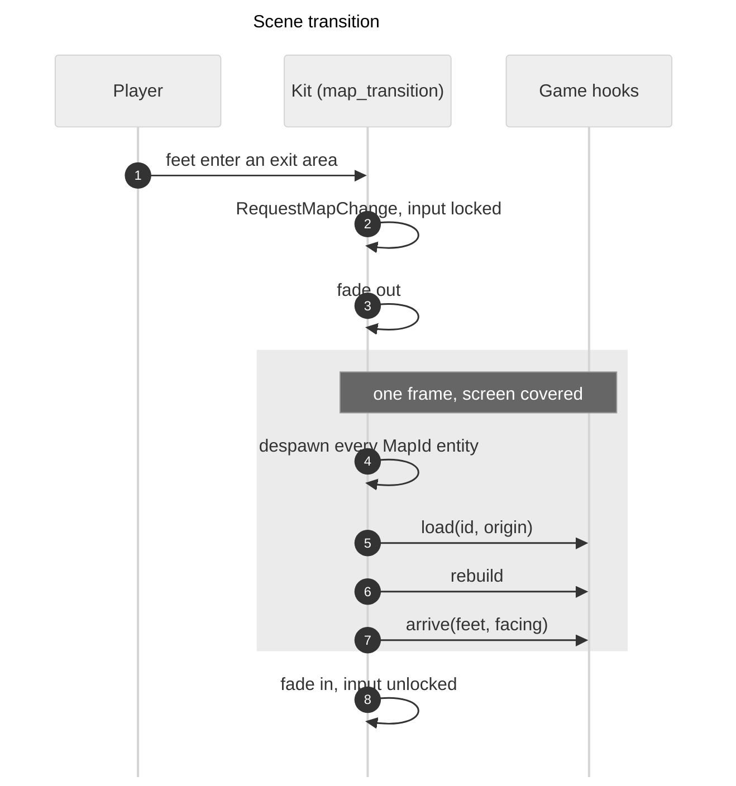

# Map transitions

How a game moves the player from one map to another. The format of the exits and entries is in [map-files.md](map-files.md). The plan, including the part that is not built yet, is `dev-docs/PLAN-map-transitions.md`.

## Status

| Part | Code | State |
|---|---|---|
| Exits, entries, links between maps | `game-kit` `map_areas.rs`, `map_links.rs` | Built (`adr-x30`) |
| Registry, lifecycle, fade (scene transition) | `game-kit` `map_transition.rs` | Built (`adr-x31`) |
| Seamless transition, eased camera bounds, grid per active map | | Not built (plan, phase C) |

## How a scene transition runs

1. The player walks into an exit area. The feet point counts, and the edges of the area are inside. An exit fires once and arms again when the feet have left every exit area.
2. The kit sends `RequestMapChange { to, entry, transition, source }`. A request during a transition is ignored.
3. The overlay (`FADE_Z_INDEX` in `layers.rs`) fades to the colour. `MapTransition::locks_input` is true from here until the fade in ends.
4. With the screen covered the kit removes every entity with `MapId`, sets `ActiveMaps` and `CameraBounds` to the new map, and runs the game hooks in order.
5. The overlay fades out and the lock ends.

A request for a map or entry that does not exist is logged and the world stays as it was. The registry checks every exit when the game starts, so this only happens with a script `goto` that has a typo.

## Where the player arrives

The player keeps their position along the strip. The offset is measured in world units from the low end of the exit strip (the smaller x of a horizontal strip, the smaller y of a vertical one) and added to the low end of the entry strip, scaled if the cell sizes differ. Across the strip the player stands in the middle of its depth. When one strip is horizontal and the other vertical, the offset moves to the other axis and the low end stays the low end (a transpose, not a rotation). A single cell, and a `goto` with no exit, put the player in the middle of the entry. Pure functions: `strip_offset` and `entry_feet`.

## What a game does

1. Add `MapTransitionPlugin { sources, kinds, start, origin, fade }`. `sources` are the map files with their ids, `kinds` the legend names, `origin` the world position of cell (0,0) of a scene transition map.
2. Insert `MapHooks`, made with `world.register_system`:
   - `load`: `In<MapLoad>`. Spawn the objects of the map and add `MapId(id)` to each one.
   - `rebuild`: clear `CollisionWorld` and add the blocked areas of the entities that exist. Runs after every load.
   - `arrive`: `In<Arrival>`. Move the player to `arrival.feet` and set the facing. The player has no `MapId`.
3. Read `ActiveMaps::current_rect()` for the map area and `MapTransition::locks_input()` to stop the player.
4. F1: call `reload_current_map(world)` from the `ReloadMap` handler.

Long Way: `games/long-way/src/map.rs` (hooks, registration), `rocks.rs` (`rebuild_collision`), `player.rs` (`arrive_player`).

## Running a transition in a scripted run

- `rust.sh script long-way "<commands>" [map-file] --debug`. The optional map file starts the game in that map (the player appears at its `player_start`). `rust.sh run long-way 2.txt` does the same for a normal run.
- `goto:<map>:<entry>` starts a scene transition and waits until it is done. The player is put in the middle of the entry.
- A walk into an exit also works: `teleport` next to it, then `hold:<direction>:<seconds>`. Add `wait` before a screenshot, because the fade takes 0.3 s out and 0.3 s in.

## Limits

- Only the scene transition is built. A `seamless` exit currently uses the same fade and logs a warning.
- A map is rebuilt from its file on every load. What the player changed in a map is not kept (see the plan, "Returning to a previous map").
- The first map is loaded in `PostStartup`. The player is spawned at the start map's `player_start` in `Startup`.
