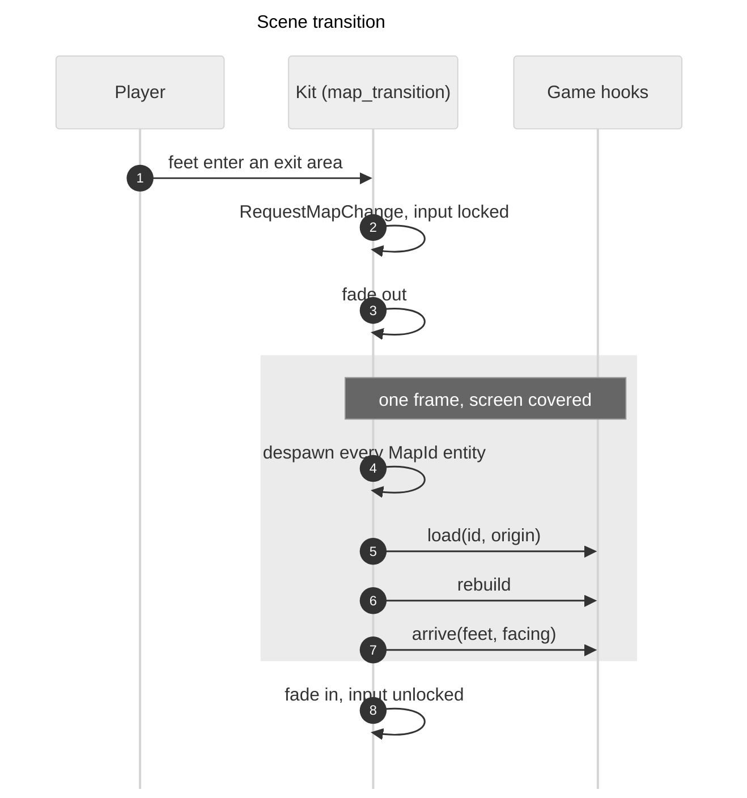
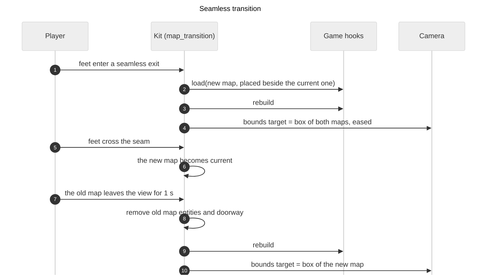

# Map transitions

How a game moves the player from one map to another. The format of the exits and entries is in [map-files.md](map-files.md). Research on other engines: `dev-docs/RESEARCH-map-transitions.md`.

## Status

| Part | Code | State |
|---|---|---|
| Exits, entries, links between maps | `game-kit` `map_areas.rs`, `map_links.rs` | Built (`adr-x30`) |
| Registry, lifecycle, fade (scene transition) | `game-kit` `map_transition.rs` | Built (`adr-x31`) |
| Seamless transition, doorways, eased camera bounds, grid per active map | `game-kit` `map_transition.rs`, `camera.rs`, `debug.rs` | Built (`adr-x32`) |

## How a scene transition runs

1. The player walks into an exit area. The feet point counts, and the edges of the area are inside. An exit fires once and arms again when the feet have left every exit area.
2. The kit sends `RequestMapChange { to, entry, transition, source }`. A request during a transition is ignored.
3. The overlay (`FADE_Z_INDEX` in `layers.rs`) fades to the colour. `MapTransition::locks_input` is true from here until the fade in ends.
4. With the screen covered the kit removes every entity with `MapId`, sets `ActiveMaps` and `CameraBounds` to the new map, and runs the game hooks in order.
5. The overlay fades out and the lock ends.

A request for a map or entry that does not exist is logged and the world stays as it was. The registry checks every exit when the game starts, so this only happens with a script `goto` that has a typo.

## How a seamless transition runs

1. The player walks into a `seamless` exit area (the camera starts to show the joined map too). The kit places the target map beside the current one (`seamless_origin`): on the edge of the exit, shifted along it so the two strips lie on top of each other. The player is not moved, the screen does not fade and input is not locked.
2. Both maps are now in `ActiveMaps`, and the link is a `Doorway`. The kit runs the `load` hook for the new map and then the `rebuild` hook, which rebuilds the collision world from every entity of every active map. While the feet are in the exit, the camera limits are the box around both maps, so the player sees ahead. In every other place it is the current map alone (`camera_target`).
3. The player may cross the seam only inside the doorway. The game keeps the feet inside `ActiveMaps::walkable(...)` with `clamp_to_union(areas, old_feet, new_feet)`: every map shrunk by the size of the body, plus a bridge over each doorway. Beside the doorway the edge is a wall as before. The result is the nearest point among the areas that hold the old feet and the areas that touch them, so a long step cannot jump a wall.
4. The current map is the map that holds the feet (`ActiveMaps::map_at`). It changes when the player crosses the seam, in either direction.
5. A map that is not the current one and is outside the camera view is removed after `UNLOAD_AFTER_SECS` (1 second): its entities, its doorway and its collision. The camera limits become the current map from the moment the player crosses the seam. The camera glides to its new place (`CameraSmoothing`): it still follows the player, and the extra move that the new limits add is eased out. It moves on until none of the map that was left is in view. How fast is set by `camera_ease_secs` of the plugin (a time constant: about two thirds of the way in that time). A scene transition makes the camera jump (`snap`).
6. Walking back through the doorway while the first map is still loaded needs no exit. If the player walks into the exit again, the map is already active and is not loaded twice.

Constraints, checked when the maps are registered (`validate_links`, `adr-x30`): the entry is on the opposite edge of the exit and has the same length, and an exit does not lead to its own map. Checked when a map joins: it must not overlap an active map. Map 3 is reached from maps 1 and 2 in Long Way, so only one of those links should be seamless unless the three maps fit together.

## Where the player arrives

The player keeps their position along the strip. The offset is measured in world units from the low end of the exit strip (the smaller x of a horizontal strip, the smaller y of a vertical one) and added to the low end of the entry strip, scaled if the cell sizes differ. Across the strip the player stands in the middle of its depth. When one strip is horizontal and the other vertical, the offset moves to the other axis and the low end stays the low end (a transpose, not a rotation). A single cell, and a `goto` with no exit, put the player in the middle of the entry. Pure functions: `strip_offset` and `entry_feet`.

## What a game does

1. Add `MapTransitionPlugin { sources, kinds, start, origin, fade, camera_ease_secs }`. `sources` are the map files with their ids, `kinds` the legend names, `origin` the world position of cell (0,0) of a scene transition map.
2. Insert `MapHooks`, made with `world.register_system`:
   - `load`: `In<MapLoad>`. Spawn the objects of the map and add `MapId(id)` to each one.
   - `rebuild`: clear `CollisionWorld` and add the blocked areas of the entities that exist. Runs after every load.
   - `arrive`: `In<Arrival>`. Move the player to `arrival.feet` and set the facing. The player has no `MapId`.
3. Keep the player inside `ActiveMaps::walkable(margin_min, margin_max)` with `clamp_to_union` (one map is the same as a clamp to its rectangle). Read `MapTransition::locks_input()` to stop the player during a fade.
4. F1: call `reload_current_map(world)` from the `ReloadMap` handler.

Long Way: `games/long-way/src/map.rs` (hooks, registration), `rocks.rs` (`rebuild_collision`), `player.rs` (`arrive_player`).

## Running a transition in a scripted run

- `rust.sh script long-way "<commands>" [map-file] --debug`. The optional map file starts the game in that map (the player appears at its `player_start`). `rust.sh run long-way 2.txt` does the same for a normal run.
- A seamless transition is a walk: `teleport` below the exit, then `hold:up:<seconds>`. Take screenshots at the seam and after the old map has been out of view for a second. The log lines of `collision:` show every rebuild (the number of clusters changes when a map joins or leaves).
- `goto:<map>:<entry>` starts a scene transition and waits until it is done. The player is put in the middle of the entry.
- A walk into an exit also works: `teleport` next to it, then `hold:<direction>:<seconds>`. Add `wait` before a screenshot, because the fade takes 0.3 s out and 0.3 s in.

## Limits

- A seamless exit needs the exit that was used (`source`). A `goto` is always a scene transition.
- Return exits are not built: the walk back works only while the first map is still loaded.
- Enemies and projectiles across a seam are not handled. `CameraBounds` is an eased box here, so a system that reads it as the playable area (enemy movement, nav) should not be used with seamless maps yet.
- Cross-seam rocks and trees do form one cluster, since collision is in world units. Long Way's map 1 and 2 have no object near the seam, so this was not seen on screen.
- A map is rebuilt from its file on every load. What the player changed in a map is not kept (see "Returning to a previous map" below).
- The first map is loaded in `PostStartup`. The player is spawned at the start map's `player_start` in `Startup`.

## Open questions

### Returning to a previous map

Nothing is decided. A map is rebuilt from its file on every load, so it comes back as authored.

- What state should a map keep when the player leaves and comes back (a destroyed rock, an opened door, a killed enemy)? Options: always reset (simple, fits a platformer stage); keep a per-map state record in a resource keyed by map id and apply it when the map loads; or keep state only for objects marked as persistent.
- Where does the player appear on return? At the named entry of the exit used. There are no return exits yet. When they are added, each exit needs a matching entry in the other map.
- In seamless mode a map that is unloaded and loaded again must give the same result at the seam.
- Enemies that follow the player across a seam, and projectiles in flight across a transition, are not handled.

### Other

- Research and the comparison with other engines: `dev-docs/RESEARCH-map-transitions.md`. The question of a Bevy asset loader for the maps is there too (roadmap item 3).
- Seamless layout: a map can be reached by one seamless link only if the maps fit together without overlapping. A map that would overlap an active map is refused.
